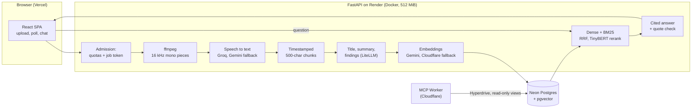

<div align="center">

# Minutes: AI Video Assistant

**Upload a short recording. Get a transcript, title, summary, action items, decisions and open questions, then ask questions and get answers with timestamped, verified quotes.**

[Live app](https://ai-video-assistant-silk.vercel.app) · [Evaluation](https://ai-video-assistant-silk.vercel.app/eval) · [Usage and limits](https://ai-video-assistant-silk.vercel.app/usage) · [How it works](https://ai-video-assistant-silk.vercel.app/pipeline)

[](https://fastapi.tiangolo.com/)
[](https://react.dev/)
[](https://vercel.com/)
[](https://render.com/)
[](https://neon.tech/)
[](https://workers.cloudflare.com/)

</div>

## Live deployment

| Part | Where | Plan |
|---|---|---|
| Web app (React + Vite) | [ai-video-assistant-silk.vercel.app](https://ai-video-assistant-silk.vercel.app) | Vercel Hobby |
| API (FastAPI, Docker) | `https://ai-video-assistant-api-sg.onrender.com` (Singapore) | Render Free, 512 MiB |
| Database | Neon Postgres + pgvector, AWS Singapore | Neon Free |
| MCP server (read-only) | `https://ai-video-assistant-mcp.jadhavsumit534.workers.dev/mcp` | Cloudflare Workers Free |

The app is in **public** mode on free model tiers, so everyone shares a small daily allowance (below). The backend sleeps after about 15 idle minutes; the first request then takes 30–60 s while it wakes. Measured live numbers are in [docs/LIVE_PERFORMANCE.md](docs/LIVE_PERFORMANCE.md); how it was deployed is in [DEPLOYMENT_REPORT.md](DEPLOYMENT_REPORT.md).

## What it does

- **Analyses a recording.** Audio up to 25 MiB, or video up to 250 MiB: the browser extracts a video's audio track before upload, so only that is sent. The first 10 minutes are used. Three demo clips are built in.
- **Writes notes.** Title, summary, action items, key decisions and open questions.
- **Answers questions with evidence.** Every answer quotes the transcript word for word with its time range. If no passage supports an answer, it says it could not find it instead of guessing.
- **Explains itself.** [`/eval`](https://ai-video-assistant-silk.vercel.app/eval) shows every evaluation result with a per-question explorer, [`/usage`](https://ai-video-assistant-silk.vercel.app/usage) shows your remaining allowance and the models in use, and [`/pipeline`](https://ai-video-assistant-silk.vercel.app/pipeline) animates the whole pipeline step by step.
- **Exposes shared recordings to AI assistants** through a read-only MCP server (4 tools, bearer-token protected).

## Architecture



- **In the browser,** video files are decoded with the built-in Web Audio API and uploaded as 16 kHz mono WAV (the format the server converts everything to), 8× smaller than a 2 Mbps 720p video in testing. If the browser cannot decode a file, the original is uploaded.
- **Processing** runs as a background task. The browser polls `GET /jobs/{id}` until the steps `audio → transcript → title → summary → extract → rag` finish; title, summary, findings and indexing run at the same time once the transcript is ready.
- **Chat** retrieves 10 passages by meaning (pgvector) and 10 by keywords (BM25), merges them with Reciprocal Rank Fusion, reranks the top 12 with a local TinyBERT cross-encoder, and sends the best 4 to one model. The model must return JSON with an exact quote for each claim; one invalid quote rejects the answer and the next free model is tried.
- **Models** are chains of free routes with automatic fallback. Paid routes are never used for visitors. Details: [operator guide](docs/HYBRID_IMPLEMENTATION.md).

## Quality and performance

| Measure | Result | Source |
|---|---|---|
| Faithfulness (judge: answers supported by retrieved text) | 1.000 on 32 answers | [Evaluation report](evaluation/EVALUATION_REPORT.md) |
| Answer relevancy | 0.986 | same |
| Citation validity | 56/56 exact quotes | same |
| Refused unanswerable questions | 6/6, no wrong refusals | same |
| Retrieval recall@4 | 0.977 | same |
| Question latency (local, warm) | p50 2.1 s, p95 5.1 s | same |
| Memory peak under 512 MiB / 0.1 CPU limit | 425.0 MiB (was 465.2) | [Audit performance notes](docs/engineering-audit/performance-and-optimization.md) |
| Live: cold start | 32.5 s and 32.6 s (two days) | [LIVE_PERFORMANCE](docs/LIVE_PERFORMANCE.md) |
| Live: ~2-minute clip, upload → notes ready | 40.7 s (23.7 s upload on mobile + 17.0 s processing) | same |
| Live: question latency | 3.4–4.5 s (n=3) | same |
| Live: first page paint (first / repeat visit) | 500–580 ms / 144–164 ms | same |

The evaluation used one public-domain talk with 45 questions; see the report for its limits.

## Usage limits

Free model tiers are shared, so limits are strict and enforced in Postgres (they survive restarts):

| Work | Limit |
|---|---|
| Analyses | 1 per visitor and 5 across all visitors per UTC day |
| Questions | 2 per minute and 15 per day per visitor, 3 per recording, 15 site-wide |
| Concurrency | One analysis and one question at a time, site-wide |
| Media | Audio 25 MiB; video up to 250 MiB, reduced to its audio in the browser; first 10 minutes analysed |

Over-limit requests get `429` with `Retry-After`. A rejected request never consumes allowance; an accepted request that later fails does. Visitors are identified by connection address, never by forwarded headers.

## Run it locally

Prerequisites: Python 3.11, Node 22 or 24, `ffmpeg`, and PostgreSQL with pgvector ([setup](docs/HYBRID_IMPLEMENTATION.md#local-setup)).

```bash
cp -n .env.example .env          # then fill in DATABASE_URL and provider settings
python3.11 -m venv .venv
.venv/bin/python -m pip install -r backend/requirements.lock
.venv/bin/python scripts/prepare_reranker.py
.venv/bin/python -m uvicorn backend.api:app --host 127.0.0.1 --port 8000 --reload --no-access-log
```

```bash
cd web && npm ci && npm run dev -- --host 127.0.0.1    # http://127.0.0.1:5173
```

`--no-access-log` matters: access logs would record bearer job IDs. Provider calls are **off** by default (`ENABLE_PROVIDER_CALLS=false`); turn them on only with verified free-tier keys. The Docker image (`docker build -t ai-video-backend .`) bundles `ffmpeg` and the reranker.

Key settings (full list in [`.env.example`](.env.example)): `DATABASE_URL`, `DEMO_LIVE_MODE` (`sample` default, `invited`, `public`), `ENABLE_PROVIDER_CALLS`, `JOB_TOKEN_SECRET` and `RATE_LIMIT_SECRET` (32+ characters), `LLM_ROUTES_JSON`, `STT_PROFILES_JSON`, `EMBEDDING_ROUTES_JSON`, `FRONTEND_ORIGIN` (exact origin, no trailing slash), `ADMIN_TOKEN`.

## Tests

```bash
PYTHON_DOTENV_DISABLED=1 .venv/bin/python -m unittest discover -s tests -v   # backend, providers mocked
cd web && npm test && npm run build                                           # frontend
node --test scripts/release_vercel.test.mjs                                  # release script
```

Database tests run when `TEST_DATABASE_URL` points at a disposable loopback Postgres with pgvector. CI also builds the Docker image, runs the suite inside it, enforces a 512 MiB / 0.1 CPU workload gate, scans the image with Trivy, and runs Playwright checks of `/eval`, `/usage` and `/pipeline` ([`ci.yml`](.github/workflows/ci.yml)). To time a deployment end to end: `python scripts/measure_live.py <backend_url> <clip>` (uses one real analysis).

## Deployment

Deployment follows [SUBMISSION_GUIDELINES.md](SUBMISSION_GUIDELINES.md): Neon → Render → Vercel → CORS → public mode → daily cleanup → MCP Worker, with an error playbook and rollback steps. The current deployment's IDs, settings (names only) and results are in [DEPLOYMENT_REPORT.md](DEPLOYMENT_REPORT.md). A GitHub Actions release path also exists ([SAMPLE_DEPLOYMENT.md](docs/SAMPLE_DEPLOYMENT.md)); it stays off while the stack is managed manually.

## Data and privacy

- Transcripts, notes and vectors stay in Neon until the visitor starts a new session, deletes the job, or the daily cleanup removes jobs older than 1 day. Uploaded audio is deleted right after transcription.
- Emails, phone numbers, card numbers and API-key-like strings are masked before anything is stored or sent to a model.
- Each job's vectors are isolated; status, results, chat and delete need a job-bound bearer token valid for 48 hours.
- Logs record sizes, counts and timings only, never transcript or answer text.
- Manual cleanup: `curl -X POST "$BACKEND_URL/admin/cleanup?older_than_days=1" -H "X-Admin-Token: $ADMIN_TOKEN"`.

## Known limitations

- **Cold starts** on Render Free: 30–60 s after idle.
- **Per-visitor limits are unreliable on Render:** the address the server sees for one device changes between requests, so a visitor can get extra analyses by retrying and strangers can share an allowance. The site-wide cap of 5 per day still holds ([LIVE_PERFORMANCE](docs/LIVE_PERFORMANCE.md), finding 10).
- **Over-limit uploads** are rejected only after the file has been received, so a visitor who is out of allowance still waits for the upload.
- **Restarts:** a job running during a Render restart is lost and can hold the processing slot until an operator runs `python -m backend.recover` ([runbook](docs/ROADMAP_STATUS.md#recovery-after-an-interrupted-process)).
- **English uploads only** in the live app; YouTube links work only from the CLI.
- **No streaming:** answers arrive in one response.

## Documentation

| Read this | For |
|---|---|
| [docs/LIVE_PERFORMANCE.md](docs/LIVE_PERFORMANCE.md) | Measured timings on the live deployment and improvement ideas |
| [docs/engineering-story/](docs/engineering-story/README.md) | Architecture decisions, bottlenecks, experiments, benchmarks, cost |
| [evaluation/EVALUATION_REPORT.md](evaluation/EVALUATION_REPORT.md) | DeepEval results, failure analysis, latency and cost |
| [docs/HYBRID_IMPLEMENTATION.md](docs/HYBRID_IMPLEMENTATION.md) | Operator guide: providers, routes, local Postgres |
| [docs/ROADMAP_STATUS.md](docs/ROADMAP_STATUS.md) | Status, open gates, recovery runbook |
| [docs/mcp-cloudflare/](docs/mcp-cloudflare/README.md) | MCP Worker design, security and deployment |
| [SUBMISSION_GUIDELINES.md](SUBMISSION_GUIDELINES.md) · [DEPLOYMENT_REPORT.md](DEPLOYMENT_REPORT.md) | How to deploy, and what was deployed |
| [AGENTS.md](AGENTS.md) · [CLAUDE.md](CLAUDE.md) | Contributor and coding-agent guide |
