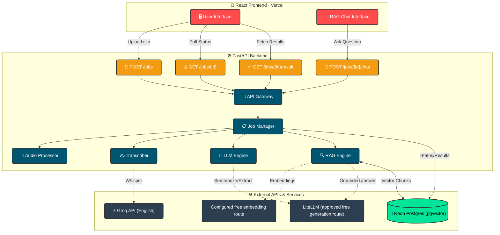

<div align="center">

# 🎬 AI Video Assistant

**Turn recordings into transcripts, findings, and answers with timestamped citations.**

[](https://fastapi.tiangolo.com/)
[](https://react.dev/)
[](https://vercel.com/)
[](https://docs.langchain.com/)
[](https://neon.tech/)

</div>

AI Video Assistant transcribes uploaded clips, extracts findings, and answers questions using the transcript. The React/Vite frontend runs on Vercel and the FastAPI backend runs on Render.

Minutes opens at `/`. Upload an English clip or pick a bundled demo video. Results show chat beside the summary and findings on desktop, chat first on mobile, and a collapsed transcript below. Links above the upload area open `/eval` (every evaluation run, with a per-question explorer), `/usage` (today's remaining allowance, models and measured tokens) and `/pipeline` (an animated walk-through of processing and chat). Live analysis supports invited and public access and is disabled in sample mode. See the [recruiter demo guide](docs/RECRUITER_DEMO.md) for configuration, verification, and release gates.

For the engineering decisions, bottlenecks, experiments and measured results behind the project, read the [engineering story](docs/engineering-story/README.md).

For handoff, open `~/Projects/AI-Video-Assistant` and start with [AGENTS.md](AGENTS.md). To deploy, follow [SUBMISSION_GUIDELINES.md](SUBMISSION_GUIDELINES.md); the deployment result is recorded in [DEPLOYMENT_REPORT.md](DEPLOYMENT_REPORT.md).

## Local hybrid retrieval upgrade

New jobs use timestamped, sanitized chunks. Dense pgvector and BM25 retrieve ten candidates each. RRF merges the rankings and a required local TinyBERT cross-encoder reranks up to twelve candidates before selecting four passages for cited chat. The generation gateway uses LangChain and LiteLLM. See the [implementation and operator guide](docs/HYBRID_IMPLEMENTATION.md) and [roadmap status](docs/ROADMAP_STATUS.md) for verified behavior and remaining release gates.

## Local safety controls

The current checkout includes admission controls. [Roadmap status](docs/ROADMAP_STATUS.md) records the remaining release gates and [the architecture review](docs/reviews/architecture-review.md) covers design limitations.

Remote inference defaults to **off** (`ENABLE_PROVIDER_CALLS=false`). Verify free entitlements and billing controls for the exact STT, generation, and embedding routes before enabling it. Configure private `RATE_LIMIT_SECRET` and `JOB_TOKEN_SECRET` values. Live demo requests use English file uploads. Indexing can fall back to another verified embedding provider on a transient failure and then pins the successful route for chat.

Default policy:

| Work | Limit |
|---|---|
| Clip submissions | 1 per client and 5 globally per UTC day |
| Media | 25 MiB upload; the first 10 minutes are analysed |
| Chat | 2 per client/minute, 3 per job/day, 15 globally/day |
| Concurrent work | One processing job and one chat request globally |
| Text | 1,000-character question, 40,000-character transcript, 1,024 output tokens per generation |

Postgres counters survive restarts and job deletion. Failed admitted work consumes allowance. Rejected admission rolls back counters. `429` includes `Retry-After`. Limiter, database, and configuration failures return `503` before inference. Clients on the same IP share quota, and the global cap applies across IPs. Status, results, chat, and deletion require a separate job-bound bearer token that expires after 48 hours.

The server uses the connection address, never arbitrary forwarded headers. Verify trusted reverse-proxy configuration before public enablement; otherwise clients may share a proxy bucket. Keep the global ceiling enabled. No production account settings or schemas were changed by these local edits.

### Tests and local-only development

Use Python 3.11 in a virtual environment. Install `backend/requirements.lock`, then run `PYTHON_DOTENV_DISABLED=1 python -m unittest discover -s tests -v`. Set `TEST_DATABASE_URL` to a disposable loopback PostgreSQL database with pgvector to run the database suite. In `web/`, use Node 22 or 24, then run `npm ci`, `npm test`, and `npm run build`. Tests mock providers. Point `VITE_BACKEND_URL` at `http://127.0.0.1:8000` during development.

### Interrupted jobs and recovery

Closing a tab leaves processing in progress. A refresh in the same tab resumes the status view. Explicit deletion during active work returns `409`. Explicit deletion and scheduled cleanup remove the job, chunks, and vector collection in one transaction. They skip active jobs and preserve usage counters.

Uncertain processing or chat work retains its reservation. Stop all old workers and suspend admissions before using `python -m backend.recover inspect` in a private terminal. The [recovery runbook](docs/ROADMAP_STATUS.md#recovery-after-an-interrupted-process) describes the 30-minute minimum age and exact owner-token check. Recovery marks an active job `interrupted` and preserves its consumed quotas. Users retry by starting a new analysis.

---

## 🏗️ Architecture Flow



---

## ✨ Features

- **Evaluation, usage and pipeline pages:** See the evaluation results, token usage and an animated pipeline explainer; evaluation and pipeline work without the backend.
- **Live clip analysis:** Upload a short English audio or video file for transcription and analysis when live access is enabled.
- **Automated Insights:** Automatically generates a suitable title, comprehensive summary, action items, key decisions, and open questions.
- **Hybrid RAG chat:** Ask about a recording and see citations with source time ranges.
- **Isolated Jobs:** Every job receives isolated processing and isolated vector storage to prevent context contamination.

---

## 🛠️ Technology Stack

### Backend
- **Framework:** FastAPI, Uvicorn
- **Audio Processing:** yt-dlp, streaming FFmpeg, pydub
- **AI/LLM:** LangChain LCEL, LiteLLM, verified free embedding routes, Groq and optional Sarvam STT, BM25, FlashRank and ONNX Runtime
- **Database & Vectors:** Neon (Serverless Postgres), pgvector, SQLAlchemy

### Frontend
- **Framework:** React 18 + Vite (static SPA)
- **Hosting:** Vercel
- **Backend calls:** `fetch` to the FastAPI service; dev uses a Vite proxy so local development works without a CORS change

---

## ⚙️ Prerequisites

Local offline tests need Python 3.11 and the backend lockfile. Running the API needs a PostgreSQL database with pgvector. Provider-backed processing additionally needs prepared reranker assets and the explicitly verified free profiles described in the [operator guide](docs/HYBRID_IMPLEMENTATION.md).

*Note: For the backend to process audio, `ffmpeg` must be installed on your system. Docker handles this natively.*

---

## 🚀 Setup & Installation

### 1. Environment Configuration

Copy the example environment file and fill in your actual credentials.
**Never commit your `.env` file to version control.**

```bash
test -f .env || cp .env.example .env
```

Ensure `.env` contains:
- `DATABASE_URL`
- `LLM_ROUTES_JSON`, `STT_PROFILES_JSON`, `EMBEDDING_ROUTES_JSON` and provider keys after account verification. See the [local PostgreSQL and provider setup](docs/HYBRID_IMPLEMENTATION.md#local-setup).
- `FRONTEND_ORIGIN` (Optional for local dev, needed for production CORS)
- `MAX_UPLOAD_MB` (optional, defaults to `25`; the ceiling is 25 MiB)
- `ENABLE_PROVIDER_CALLS`, `RATE_LIMIT_SECRET`, and the quota controls documented above (see `.env.example`)
- `DEMO_LIVE_MODE` (defaults to `sample`), `JOB_TOKEN_SECRET` for live mode, and `DEMO_INVITE_CODE` for invited mode
- `MAX_MEDIA_SECONDS` (optional, defaults to `600`; longer recordings are trimmed to this ceiling of ten minutes)
- `ADMIN_TOKEN` (Optional — enables the token-gated `/admin/cleanup` endpoint; unset means the endpoint stays disabled)

### 2. Backend setup

For a native development server, follow the [loopback PostgreSQL setup](docs/HYBRID_IMPLEMENTATION.md#local-setup) and run the commands below from the repository root. Install `ffmpeg` separately.

```bash
python3.11 -m venv .venv
.venv/bin/python -m pip install -r backend/requirements.lock
.venv/bin/python scripts/prepare_reranker.py
.venv/bin/python -m uvicorn backend.api:app --host 127.0.0.1 --port 8000 --reload --no-access-log
```

The Docker image includes `ffmpeg` and the reranker. For a containerized development server, configure `DATABASE_URL` with a database hostname reachable from inside the container. The loopback DSN from the native setup points to the backend container itself when used in Docker.

```bash
# Build the Docker image
docker build -t ai-video-backend .

# Run the container (reads from your .env file)
docker run -p 127.0.0.1:8000:8000 --env-file .env ai-video-backend
```

### 3. Frontend Setup

In a separate terminal, install and run the React frontend.

```bash
cd web
npm ci
npm run dev -- --host 127.0.0.1
```

Open `http://127.0.0.1:5173/`, `/eval`, `/usage` or `/pipeline`. Vite proxies API calls to `http://localhost:8000` by default. Set `VITE_BACKEND_URL=http://127.0.0.1:8000` in `web/.env` to use an IPv4 loopback backend explicitly. See `web/.env.example`.

---

## ☁️ Deployment Strategy

Use the [sample deployment runbook](docs/SAMPLE_DEPLOYMENT.md) for Render, Vercel, Neon, Cloudflare, and GitHub setup. Native AMD64 workload and exact-image scan results gate the sample deployment. Provider account checks gate live inference separately.

- **Backend:** The existing **Render Free** service runs FastAPI using the provided `Dockerfile`. It processes uploads in background tasks after admission.
- **Frontend:** Deploy the `web/` React app to **Vercel** — import the repo, set **Root Directory** to `web` (framework auto-detects as Vite), and add **`VITE_BACKEND_URL`** = the backend URL. Then add the resulting Vercel origin to the backend's `FRONTEND_ORIGIN` (comma-separated, **no trailing slash**) so CORS admits it.
- **Database:** **Neon** Serverless Postgres perfectly handles the relational states and vector storage via `pgvector`.
- **Scheduled cleanup:** A GitHub Actions workflow (`.github/workflows/cleanup.yml`) calls `POST /admin/cleanup?older_than_days=1` daily. Its `ADMIN_TOKEN` repository secret must match the backend secret.

---

## 🗑️ Data Lifecycle

Job transcripts, summaries, findings, and vectors live in Neon until explicit deletion or scheduled cleanup.

- **New session** deletes the previous job, transcript chunks, and vector collection. Closing or refreshing the tab leaves the job available.
- **Scheduled cleanup** sweeps eligible terminal jobs 24 hours after their last update. It skips jobs with active work.

To purge on demand, call the endpoint directly (never commit the token or paste it in chat):

```bash
curl -X POST "https://<backend-url>/admin/cleanup?older_than_days=1" \
  -H "X-Admin-Token: $ADMIN_TOKEN"
# → {"deleted": N, "older_than_days": 1}
```

`older_than_days=0` purges eligible inactive jobs; active work is excluded. Returns `503` if `ADMIN_TOKEN` is unset, `401` on a bad token.

---

## ⚠️ Known Limitations & Notes

- **Cold starts:** Render's free tier sleeps the backend after 15 minutes idle; the first request afterwards takes up to ~60s. The frontend surfaces this as a "waking up" message rather than an error.
- **Memory:** Audio is decoded and chunked in a single streaming `ffmpeg` pass (`-vn -ac 1 -ar 16000 -f segment`), so memory stays flat regardless of length. This replaced an in-memory `pydub` path that loaded the whole file's PCM into RAM twice and exceeded Render's 512MB limit on long uploads.
- **Upload cap:** A request-body limit runs before multipart parsing with bounded overhead. The route also verifies the file size and duration. The frontend blocks files above 25 MiB before upload and warns when only the first 10 minutes will be analysed.
- **Ephemeral Storage:** Audio files are heavily chunked to fit API payload limits (e.g., Groq's 25MB cap) and are immediately deleted post-transcription. No raw audio is persistently stored.
- **CORS:** `FRONTEND_ORIGIN` must be the exact origin with **no trailing slash** — browsers never send one, so a trailing slash silently blocks every request.
