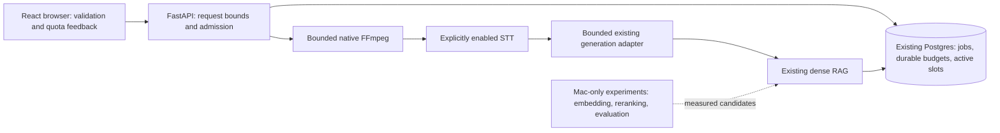

# AI Video Assistant: Free-Only Upgrade Plan

**Implementation update, 2026-11-11.** The approved hybrid revision replaces the full-text-search proposal below with BM25 and makes FlashRank reranking required. See the [current roadmap status](docs/ROADMAP_STATUS.md) for implemented work, benchmark findings and outstanding gates, and the [hybrid guide](docs/HYBRID_IMPLEMENTATION.md) for configuration. The roadmap below preserves the earlier design.

Reviewed 2026-11-05. The user's current instruction authorizes local implementation after review, superseding the supplied brief's planning-only restriction. Work remains on `work/project-updates`; no push, cloud migration, deployment, paid service, or live inference is authorized by this plan.

## Recommendation and approval

**Conditionally approved:** start with abuse prevention, bounded workloads, cleanup, and offline tests. Preserve React, FastAPI, native FFmpeg, and Neon/pgvector. Keep heavy models off Render. The independent [architecture review](docs/reviews/architecture-review.md) records the EGM design critique and source evidence.

**Not approved for live enablement yet:** the existing pipeline's billing status, a second generation provider, automatic provider fallback, a LiteLLM release, new embeddings, or production schema changes. A key/model name cannot establish that a request is free. Existing provider compatibility remains behind an explicit disabled-by-default gate.

**Revised order:** security and durable budgets → provider/account verification → segment/chunk provenance contract → hybrid retrieval → optional experiments → final evaluation. Timestamp identity must precede the hybrid schema, avoiding two incompatible chunk stores.

## Repository audit

Confirmed from source:

- `backend/api.py` accepts uploads/URLs and serves job status, results, chat and deletion; `jobs.py` runs synchronous stages inside FastAPI background tasks.
- `db.py` stores results in Postgres. Progress updates are not resumable stage checkpoints.
- `core/` uses Groq for English STT, Sarvam for Hinglish, and Mistral for generation and embeddings. Five or more generation calls can be made per job; long-summary mapping adds calls.
- Dense RAG uses 500-character chunks, 50-character overlap and top four retrieval. Chunk metadata lacks time provenance. No sparse retrieval or reranker exists.
- `web/` is React/Vite. Initially its development proxy points to production. Backend dependencies were broadly versioned; a frontend lockfile existed, but no test suite was configured.
- `render.yaml` declares Free; it does not prove the live account plan, payment methods, provider quotas or billing controls.

Verified weaknesses: no public inference quotas; oversized bodies are parsed before route validation; arbitrary URL strings can reach local-file/generic-download paths; deletion does not cancel background work; temporary files can leak on failures; FFmpeg and generation are unbounded; Sarvam environment configuration loads too early; status polling selects complete results; raw question/answer logging exposes content.

## Target architecture

Hosted mode stays lightweight. Local mode uses the same backend and contracts; heavy model experiments are separate optional development workloads. No separate proxy, Redis, worker service, Elasticsearch or vector database is needed now.

## Selected demo policy

These are application policy ceilings, **not provider entitlements**:

| Resource | Default |
|---|---|
| Video submissions | 2/client/UTC day; 10 globally/UTC day |
| Processing concurrency | 1 globally, no waiting queue |
| Upload/media | 25 MiB file; 600 seconds |
| Chat requests | 5/client/minute; 20/client/day; 10/job/day; 100 globally/day |
| Chat concurrency | 1 globally |
| Questions/transcripts | 1,000 / 40,000 characters |
| Generation | 1,024 output tokens; finite timeout; no SDK retries |
| Remote execution | Disabled unless explicitly enabled after account verification |
| Sarvam/YouTube | Independently disabled by default |

Postgres owns fixed-window counters and active reservations. A short transaction locks one guard row, checks every scope, increments all counters and acquires a token-owned slot atomically. Rejection rolls back everything. Admitted failures consume allowance because remote usage may already have occurred. Deleting a job never resets quota. Prune expired windows without deleting current usage.

Client keys are HMACs of normalized connection addresses, with a stable private secret. Do not trust arbitrary `X-Forwarded-For`; configure trusted proxies only after verifying the deployment path. Unverified proxy attribution can group users together; global budgets remain effective. Shared campus/NAT addresses share quota. IP rotation can bypass individual limits but cannot bypass the global ceiling. This is an anonymous demo, not strong identity or DDoS protection; job IDs remain bearer secrets and must not be shared.

Quota denial returns `429` with `Retry-After`; unavailable quota storage/configuration returns `503` before inference. Body limits run before parsing, including chunked requests. Active deletion returns `409`: closing a tab is not cancellation. A worker releases its matching slot in `finally`. Crashes retain reservations fail-closed; no automatic expiry/replay is claimed. Recovery requires stopping all old workers, marking interrupted jobs, then clearing the stale slot explicitly.

## Technology decisions

| Area | Status and choice | Cost/resource implications and alternative |
|---|---|---|
| Provider gateway | **Recommended now:** small direct adapter around installed Mistral/LangChain integration | No new package/service. Add LiteLLM only after artifact/security and compatibility review. |
| Groq | **Needs account verification:** existing English STT | Public Free tier is limited; verify organization limits and no paid upgrade. No inference during this change. |
| Mistral | **Needs account verification:** retain generation/embedding compatibility | Public included usage does not prove this account/model is enabled for free. No paid fallback. |
| Sarvam | **Confirmed:** signup credit, not demonstrated recurring free allowance | Default off. A finite trial is unsuitable as the required indefinitely free Hinglish path. |
| Neon/Postgres | **Recommended:** existing database, short row-lock transactions | No new service; account capacity remains unverified. Avoid session locks with pooled connections. |
| Hybrid retrieval | **Recommended later:** Postgres FTS + pgvector + RRF | PostgreSQL/pgvector permissive licenses; existing compute/storage quotas still apply. No external search server. |
| FastEmbed / reranking | **Optional local benchmark** | FastEmbed is Apache-2.0; model licenses vary. Measure weight size, runtime RSS, CPU latency and quality before selection/download. No Render model loading. |
| Browser media | **Optional experiment:** worker-based extraction with fallback | ffmpeg.wasm is MIT, bundled FFmpeg/core licenses require separate review. Official benchmarks show slower conversion than native; smaller uploads alone prove no speed benefit. |
| WebGPU STT/reranking | **Deferred experiment** | Transformers.js is Apache-2.0; downloads/device compatibility and model licenses still matter. Never required for core flow. |
| DeepEval | **Deferred final phase** | Local library does not make hosted judges free. Study materials and judge policy remain missing. |

The official October LiteLLM incident affected `1.107.0`; the March affected versions were `1.82.7`/`1.82.8`. Signed publishing alone did not prevent the October incident. No safe artifact is selected or installed here.

## Implementation backlog and acceptance

### Phase 1 — Safety foundation: implement now

Files: `api.py`, `db.py`, `jobs.py`, `usage_limits.py`, `utils/audio_processor.py`, provider modules, frontend API/input/chat, environment examples and regression tests.

1. Write failing tests for disabled inference, quota denial, DB outages, atomic admission, spoofed headers, invalid source/language, oversized/chunked bodies, and active deletion.
2. Add additive quota/slot tables and bounded validated settings. Test real competing transactions in disposable local Postgres, including rollback and wrong-owner release.
3. Bound media before STT; isolate downloads, restrict protocols, reject unknown/long duration, and clean artifacts on subprocess/download/DB failures.
4. Gate every provider entry point, including CLI factories, STT and embeddings. Bound output/time/retries; never download a tokenizer during disabled-mode tests.
5. Keep frontend development local, mirror limits, block duplicate chat sends and display server denial/retry messages without automatic inference retries.
6. Log stage timing/status without transcript text. Run offline tests and frontend production build. Preserve original brief and existing changes.

Acceptance: rejected or disabled requests make zero inference calls; quotas persist independently of job deletion; concurrent SQL admissions respect caps; files disappear on failures; valid mocked upload→result→chat flows remain usable. No live-provider success or latency/quality gain is implied. Rollback: reverse local patches; leave additive unused quota tables intact. Do not roll back to publicly unlimited inference.

### Phase 2 — Provider and account contract

Verify Render/Neon plans and limits, payment-method/overage controls, every STT/generation/embedding model and free allowance, privacy terms and provider token/audio budgets. No account changes without authorization. Decide at most two generation providers and exact model identifiers. Freeze reviewed dependencies/lockfiles and disabled fallback policy. A 40,000-character cap is not proof of a provider token budget. Test normalized errors/usage with mocked transports. Live smoke tests require verified free-only accounts and explicit bounded workload. Rollback to disabled provider gate.

### Phase 3 — Provenance and hybrid retrieval

First define `TranscriptSegment`/`Chunk` with stable ID, job ID, text, start/end, precision label, model/version/dimension. Preserve provider times or label coarse/unknown ranges honestly. Proposed application-owned `transcript_chunks` table has a job foreign key with cascading deletion, vector column, `tsvector`, and GIN index. Never mix embedding spaces. Keep legacy PGVector collections readable; no destructive backfill.

Implement job-filtered dense and FTS retrieval, deterministic RRF (initial candidates 10/side, fusion constant 60, final 4), plus citations. Counts are benchmark defaults. Files: transcriber/vector/RAG modules, additive migration, response schema and result/chat UI. Tests: job isolation, stable duplicate fusion, empty/no-match retrieval, genuine timestamps, deletion, legacy compatibility and rollback. Compare fixed questions against baseline; do not claim improvement without measured relevance. Rollback switches new jobs to legacy retrieval; retain old vectors and new tables until verified.

### Phase 4 — Optional measured experiments

Benchmark local FastEmbed, a small cross-encoder and browser extraction separately on fixed media/questions. Record cold download, peak RSS, latency, upload bytes, compatibility and relevance. Adopt only a measured benefit with a working no-rerank/native fallback. Do not migrate embeddings or make browser processing mandatory speculatively. Each experiment has its own dependency/license review and feature toggle; rollback disables it.

### Phase 5 — Evaluation and deployment readiness

Wait for `rag-eval-deepeval-main`. Freeze dataset, questions, reference answers/context and model/chunk versions. Export retrieved IDs/ranks/context, answers, latency and usage; compare dense, hybrid, and reranked variants only where implemented. Separate retrieval metrics from judge-based metrics; manually reviewed/local judges avoid unapproved spending. No fabricated results. Deploy only after user authorization, backup/rollback review, provider verification and local checks; Docker validation is pending when Docker is unavailable.

## Operational limits and unresolved work

No authenticated billing dashboard is connected in this task. Plugin discovery found Render/Neon integrations available but not installed; no account inspection was performed. Provider calls, production database changes, restart/resume, new retrieval quality and hosting memory headroom remain unverified. FastAPI background work is not durable; lost uploads require re-upload after interruption. Total YouTube metadata/download wall time is not strictly bounded by socket timeouts; keep it disabled on the hosted demo.

Read endpoints still need protection from volumetric abuse at the hosting edge; application inference quotas do not replace that. A separate capability-token migration can strengthen bearer job access later. Avoid adding login infrastructure without a demonstrated requirement.

## Official research sources

- [Render Free](https://render.com/docs/free): idle restart/ephemeral files, 750 hours, billing/suspension nuances.
- [Neon pricing](https://neon.com/pricing) and [pooling](https://neon.com/docs/connect/connection-pooling): public allowances are not account verification.
- [Groq rate limits](https://console.groq.com/docs/rate-limits) and [billing](https://console.groq.com/docs/billing-faqs).
- [Mistral usage limits](https://docs.mistral.ai/admin/billing-usage/usage-limits).
- [Sarvam pricing](https://docs.sarvam.ai/api/getting-started/pricing): finite signup credits.
- [LiteLLM October security report](https://litellm.vercel.app/blog/security-changes-after-oct-21-2026).
- [Postgres FTS](https://www.postgresql.org/docs/current/textsearch.html), [row locking](https://www.postgresql.org/docs/current/explicit-locking.html), [pgvector hybrid search](https://github.com/pgvector/pgvector#hybrid-search).
- [FastEmbed](https://qdrant.github.io/fastembed/), [ffmpeg.wasm performance](https://ffmpegwasm.netlify.app/docs/performance/), [Transformers.js WebGPU](https://huggingface.co/docs/transformers.js/guides/webgpu).
