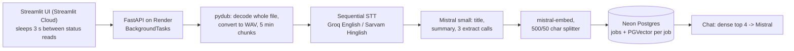
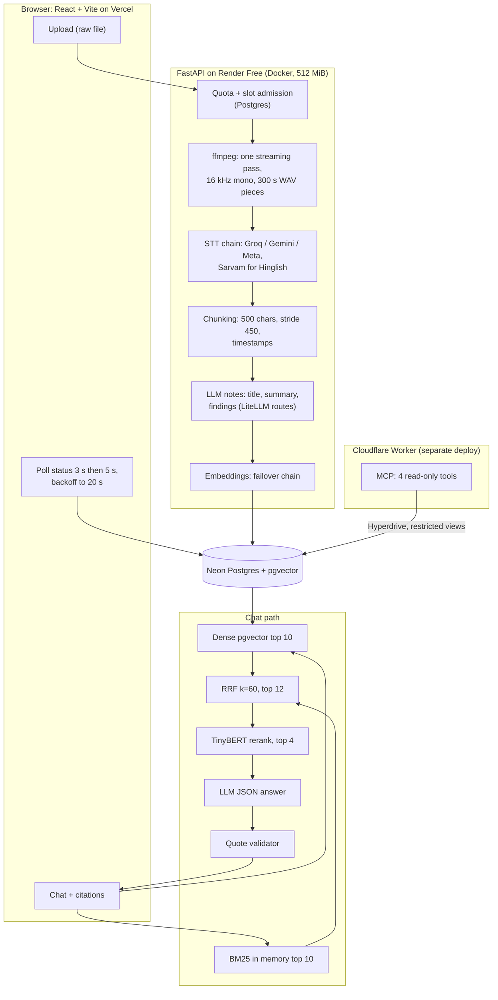

# Engineering story: Minutes (AI Video Assistant)

Purpose: one-page entry point to the engineering decisions, bottlenecks, experiments and measured results behind this project, with every claim tied to a tracked source.

**Status legend.** Implemented = in the code on this branch. Verified = implemented and backed by a test or measurement cited here. Planned = documented intent, no code. Experimental = built or measured offline, not in the product. Not implemented = discussed or expected, no code. "Not measured" = no source has the number; the doc says how to measure it.

**Evidence rules.** Numbers are copied from the cited tracked file. Measured, estimated and expected values are labelled. Nothing here comes from `output/` or `.env`. Branch: `eval/deepeval-framework`.

## 1. Project overview

Minutes takes a short English video or audio clip (upload only, 25 MiB cap, first 600 s analysed) and returns a transcript, a title, a summary, action items / decisions / open questions, and a chat box. Chat answers come from hybrid retrieval over the transcript and cite timestamped quotes. If the model's quote cannot be found in the retrieved text, the answer is rejected and the next model route is tried; if no route passes, the call fails with a 503, as happened for 2 of 45 evaluation questions. Hinglish goes through Sarvam when enabled (it is off in the shipped `render.yaml`). Everything runs on free tiers: Vercel (UI), Render Free Docker (API, 512 MiB), Neon Postgres with pgvector, free-tier LLM/STT/embedding providers.

Status: Implemented. Sources: [`backend/api.py`](../../backend/api.py), [`backend/jobs.py`](../../backend/jobs.py), [`render.yaml`](../../render.yaml), [`backend/usage_limits.py`](../../backend/usage_limits.py).

## 2. Original architecture (commit `29eddf7`, 2026-07-13)

Before this commit the project was a local CLI (`main.py`) with local `openai-whisper` + `torch` and a local Chroma collection shared by all videos. The plan to split it is in `git show 29eddf7:DEPLOYMENT_PLAN.md` (file removed later; read it with `git show`). The pre-git CLI itself is not in the repo history, so no code or timing for it can be cited. No latency or quality baseline was ever recorded for any early version: **Not measured**.

Evidence for the diagram: `git show 29eddf7:backend/utils/audio_processor.py` (pydub `AudioSegment.from_file` / `from_wav`, 5-minute chunks), `backend/core/transcriber.py` (`transcribe_all` loops chunks one by one), `backend/core/vector_store.py` (`mistral-embed`, collection per job, splitter 500/50), `backend/core/rag_engine.py` (`k = 4`), `frontend/app.py:491` (`time.sleep(3)`), `backend/db.py:114` (`SELECT * FROM jobs`). Status: Not in the product any more.

## 3. Current architecture

Status: Implemented. Sources: [`backend/jobs.py`](../../backend/jobs.py):34-129 (stage order), [`backend/core/retrieval.py`](../../backend/core/retrieval.py):62-108, [`backend/core/reranker.py`](../../backend/core/reranker.py), [`backend/core/rag_engine.py`](../../backend/core/rag_engine.py), [`web/src/App.jsx`](../../web/src/App.jsx):13-17,99-190, [`docs/mcp-cloudflare/architecture.md`](../mcp-cloudflare/architecture.md). The architecture was exercised end to end with mocked or free providers on local Docker; hosted Render/Vercel/Cloudflare/Neon checks are still pending ([`docs/ROADMAP_STATUS.md`](../ROADMAP_STATUS.md):41-46).

## 4. Main engineering challenges

| Challenge | What the repo shows | Status |
|---|---|---|
| 512 MiB RAM on Render Free | Early pydub path decoded PCM into RAM twice and hit "Ran out of memory" (fixed in `0ea372e`). A CI-style gate (512 MiB, no swap, 0.1 CPU) peaked at 425.0 MiB cgroup after audit 2, down from 465.2 MiB (original image failed the gate). | Verified (local Linux arm64, n=1) |
| Free-only providers and quotas | Every route needs a `verified_free` attestation; app-side rpm/tpm/rpd ledgers in Postgres; paid Meta route is off by default and capped at $0.01/job, $0.05/day. | Implemented |
| Retrieval quality and grounding | Dense + BM25 + RRF + TinyBERT; answers must carry exact quotes. 14 of 57 model outputs were rejected by the validator in the DeepEval run, 0 fabricated. | Verified (one source talk, 45 goldens) |
| Abuse and cost limits | 1 job/IP/day, 5 jobs/day globally, chat caps, one processing slot, HMAC job tokens. Per-IP keys behind Render's proxy are unconfirmed. | Implemented; proxy attribution not verified |
| Reliability on Render restarts | Background work is not durable. A killed worker leaves its slot held until an operator runs `python -m backend.recover` after 30 minutes. | Implemented (manual); auto-recovery rejected |

Details: [bottleneck-analysis.md](bottleneck-analysis.md).

## 5. Optimization strategy

1. Remove the cause first: stream audio through ffmpeg instead of loading it; bound inputs (25 MiB, 600 s, 1 MiB copy chunks) before spending provider quota.
2. Keep heavy models off Render: the only local model is the 2-layer TinyBERT reranker; STT, LLM and embeddings are remote free routes with failover.
3. Fail closed on money: pessimistic reservations before each provider call, per-job attempt/token ceilings.
4. Measure before keeping a change: browser ffmpeg.wasm, local BGE embeddings, a psycopg pool, a v2 RAG pipeline and startup auto-recovery were each tried or considered and not adopted, with reasons in [optimization-and-experiments.md](optimization-and-experiments.md).
5. Say what is not measured. No latency or quality baseline exists for the original app, upload duration and compressed size were never measured, and no response caching exists.

## 6. Major decisions (summary)

Full reasoning, alternatives and trade-offs: [architecture-and-decisions.md](architecture-and-decisions.md).

| Decision | Outcome | Status |
|---|---|---|
| React + Vite replaces Streamlit | Static UI on Vercel; custom polling and citation UI | Implemented |
| FastAPI + Docker on Render | ffmpeg needs a binary; Docker chosen | Implemented |
| LiteLLM with several free providers | App-level fallback loop, one model per Router call | Implemented |
| Neon Postgres + pgvector | One store for jobs, vectors, quotas, slots | Implemented |
| BM25 in memory instead of Postgres FTS | Plan changed on 2026-11-11; reason not documented beyond the plan note | Implemented |
| RRF (k=60) | Deterministic fusion of two top-10 lists | Implemented |
| FlashRank TinyBERT reranker | Mandatory; failure stops generation | Implemented (value on real data not shown) |
| Browser audio extraction | Not enabled | Experimental, rejected |
| SSE / streaming | Polling with backoff chosen | Not implemented |
| Job management | BackgroundTasks + Postgres slots + manual recovery | Implemented; no checkpointing |
| Remote MCP on Cloudflare Worker | 4 read-only tools via Hyperdrive | Implemented, separate deploy |
| DeepEval | v1 run complete, v2 pipeline parked | Implemented / Experimental |

## 7. Status table

| Area | Implemented | Verified | Planned | Experimental | Not implemented |
|---|---|---|---|---|---|
| Streaming ffmpeg audio | yes | cgroup gate, arm64 | | | |
| Sequential STT with fallback chain | yes | mocked-provider tests | | | Parallel STT (except paid Meta route) |
| Embedding failover | yes | unit tests; Cloudflare probe (1,024 dims) | | Local BGE-small (offline only) | |
| Hybrid retrieval + rerank | yes | DeepEval n=37 ablation | Blend rerank score with RRF | v2 pipeline (parked) | |
| Citation validator | yes | 56/56 valid in eval | | | |
| Quotas and slots | yes | 8 concurrent submissions -> 1 admitted (Phase 1) | Trusted-proxy setting | | |
| Recovery | yes (manual) | | | | Checkpointing, auto-resume |
| Observability | log lines only | | | | External metrics sink |
| Caching | | | | | Yes (none beyond singletons) |
| SSE / streaming | | | | | Yes |
| Browser preprocessing | | | | yes, rejected | |
| YouTube | CLI only | | | | Live API (URLs rejected) |
| MCP Worker | yes | local runtime tests, Wrangler dry run | Hosted checks | | |
| DeepEval | yes (v1) | report | Multi-source goldens, human review | | |

Sources: [`docs/ROADMAP_STATUS.md`](../ROADMAP_STATUS.md), [`docs/engineering-audit/remaining-issues.md`](../engineering-audit/remaining-issues.md), [`evaluation/EVALUATION_REPORT.md`](../../evaluation/EVALUATION_REPORT.md), [`docs/UPGRADE_VALIDATION.md`](../UPGRADE_VALIDATION.md).

## 8. Timeline (from `git log`)

| Date | Commit | Change |
|---|---|---|
| 2026-07-13 | `29eddf7` | Split into FastAPI backend + Streamlit frontend (22 files) |
| 2026-07-14 | `3934fa3` | Upload becomes the primary path; YouTube limitation documented |
| 2026-07-16 | `327c06b` | Streamlit replaced by React/Vite "Minutes" for Vercel |
| 2026-07-16 | `0ea372e` | Stream audio with ffmpeg to end Render OOM |
| 2026-07-17 | `73cdd5b`, `1d43204` | Token-gated cleanup endpoint and daily cleanup workflow |
| 2026-11-12 | `cfee048` | Hybrid retrieval, reranker, quotas, recovery, MCP Worker, benchmarks |
| 2026-11-12 | `21933b5`, `239dfe3` | Audit 1 hardening; zlib upgrade in image |
| 2026-11-12 | `0e8d9cd` | CI-gated deployments |
| 2026-11-12 | `2622753` | Embeddings across free providers |
| 2026-11-12 | `37ac7ea` | Minutes restored, demo analysis streamlined |
| 2026-11-13 | `69e3e8c` | Per-task model fallback, 10-minute uploads, STT fallback chain |
| 2026-11-13 | `6ac48a2` | Hinglish and Hindi via Sarvam with Groq translation fallback |
| 2026-11-13 | `1c5adba` | Engineering audit 2 hardening (PR #6) |
| 2026-11-13 | `311bf28`, `7c9e3f0` | DeepEval framework; evaluation run and report |
| 2026-11-13 | `884c238` | Embedding fallback chain; v2 pipeline parked |
| 2026-11-13 | `6b1b29b` | /eval, /usage, /pipeline info pages replace /sample |

Source: `git log --format='%h %ad %s' --date=short` on this branch (full list has 34 commits; docs-only and merge commits omitted). `cfee048` changed 100 files, 13,167 insertions and 1,801 deletions (`git show --shortstat cfee048`).

## 9. Documents in this folder

| Doc | Content |
|---|---|
| [README.md](README.md) | This overview |
| [architecture-and-decisions.md](architecture-and-decisions.md) | Per-technology decisions, alternatives, trade-offs |
| [bottleneck-analysis.md](bottleneck-analysis.md) | 12 bottlenecks with root cause and status |
| [optimization-and-experiments.md](optimization-and-experiments.md) | Experiments: hypothesis, change, result, decision |
| [benchmarking-and-performance.md](benchmarking-and-performance.md) | Methods, environments, results, gaps |
| [cost-and-resource-optimization.md](cost-and-resource-optimization.md) | Free-tier limits, budgets, measured spend |
| [evaluation-strategy.md](evaluation-strategy.md) | DeepEval and IR evaluation design and results |
| [resume-and-portfolio-evidence.md](resume-and-portfolio-evidence.md) | Claims with evidence links |

## 10. Known documentation drift (not edited here)

- `AGENTS.md`, `docs/ROADMAP_STATUS.md` and `docs/RECRUITER_DEMO.md` still mention the removed `/sample` flow and PR #4; the latest commit `6b1b29b` replaced `/sample`.
- `docs/BENCHMARK_NOTES.md`:38 says the Linux gates have not been run; later docs record Linux runs.
- Demo limits: `UPGRADE_IMPLEMENTATION_PLAN.md` (removed; `git show dfa7e60:UPGRADE_IMPLEMENTATION_PLAN.md`) lists 2 jobs/client/day and 10 globally; code defaults are 1 and 5 ([`backend/usage_limits.py`](../../backend/usage_limits.py):42-48). Code wins. `render.yaml` sets `CHATS_PER_IP_DAY` to 15 while the code ceiling is 20.

## Sources

- `UPGRADE_IMPLEMENTATION_PLAN.md` (removed; read with `git show dfa7e60:UPGRADE_IMPLEMENTATION_PLAN.md`), [`docs/HYBRID_IMPLEMENTATION.md`](../HYBRID_IMPLEMENTATION.md), [`docs/reviews/architecture-review.md`](../reviews/architecture-review.md)
- [`docs/engineering-audit/`](../engineering-audit/README.md): README, performance-and-optimization, remaining-issues
- [`docs/mcp-cloudflare/`](../mcp-cloudflare/README.md)
- [`evaluation/EVALUATION_REPORT.md`](../../evaluation/EVALUATION_REPORT.md)
- [`docs/ROADMAP_STATUS.md`](../ROADMAP_STATUS.md), [`docs/RECRUITER_DEMO.md`](../RECRUITER_DEMO.md)
- Git history: `29eddf7`, `3934fa3`, `0ea372e` (read with `git show`)
