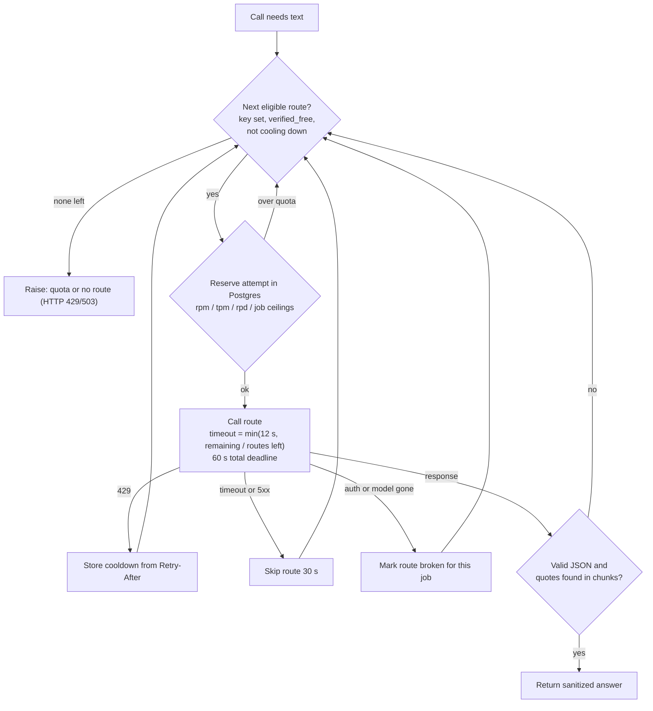

# Architecture and decisions

Purpose: for each major technology in Minutes, the problem it addresses, why it was chosen, what else was considered, and what it costs.

**Status legend.** Implemented / Verified (tested, evidence cited) / Planned / Experimental / Not implemented. Rejections are listed only where a tracked source records them; otherwise "No alternative documented". Overview: [README.md](README.md).

## Decision diagram: LLM route fallback (chat and notes)

Every generation call walks an ordered list of free routes. The loop is in application code, not inside LiteLLM: each attempt builds a single-model `litellm.Router` with retries and fallbacks set to 0.

Sources: [`backend/core/llm_gateway.py`](../../backend/core/llm_gateway.py):225 (single-model Router), :353 (60 s deadline), :388 (per-route timeout), :186 and :410-420 (cooldowns), :439-452 (eligibility), [`backend/core/rag_engine.py`](../../backend/core/rag_engine.py):76-80 (validator failure moves to next route).

---

## 1. React + Vite (replaced Streamlit)

| | |
|---|---|
| Problem | The first split (`29eddf7`) used a 648-line Streamlit app (`frontend/app.py`) that polled with `time.sleep(3)` and `st.rerun()` (lines 491-499 at that commit). |
| Why selected | Commit `327c06b` replaced it with a static React/Vite SPA deployable on Vercel. The documented motive in the commit is deployment on Vercel; a UX or performance comparison was **not measured**. |
| Alternatives | No alternative documented. |
| Cost / resources | Vercel static hosting; `web/vercel.json` adds security headers and a CSP; deployments are disabled in git (`"git": {"deploymentEnabled": false}`). |
| Trade-offs | More frontend code to own: polling, session storage, abort handling, citation seek UI. All backend calls go through [`web/src/api.js`](../../web/src/api.js). |
| Status | Implemented. 15 web tests per the local run check. |

## 2. FastAPI (Docker on Render)

| | |
|---|---|
| Problem | A single local CLI could not serve a browser; uploads and analysis take longer than a request should. |
| Why selected | `DEPLOYMENT_PLAN.md` at `29eddf7` specifies FastAPI on Render Free with a background-task pattern. The Dockerfile comment says Render's native Python runtime has no ffmpeg binary, hence Docker ([`Dockerfile`](../../Dockerfile):1-2). |
| Alternatives | A Python-native Render runtime: rejected because no ffmpeg (same Dockerfile comment). No other alternative documented. |
| Cost / resources | Render Free: 512 MiB, idle spin-down (cold start up to about 60 s per the `3934fa3` README), ephemeral disk. Image 1.69 GB after audit 2 (from 1.75 GB). Runs as non-root uid 65532, `--no-access-log` so job IDs stay out of logs. |
| Trade-offs | Free tier restarts can kill in-flight work (see section 9). `/health` is static liveness; `/ready` checks the database ([`backend/api.py`](../../backend/api.py):303-311). |
| Status | Implemented. Memory gate Verified on Linux arm64; native AMD64 on current head pending ([`remaining-issues.md`](../engineering-audit/remaining-issues.md):17). |

## 3. LiteLLM + several free providers (replaced Mistral)

| | |
|---|---|
| Problem | The original code built Mistral clients directly for summary, extraction, RAG and embeddings. The architecture review found no verified free-only path: Mistral API access needs billing ([`HYBRID_IMPLEMENTATION.md`](../HYBRID_IMPLEMENTATION.md):85; [`architecture-review.md`](../reviews/architecture-review.md):15). |
| Why selected | Routes are declared in `LLM_ROUTES_JSON` with `verified_free`, rpm/tpm/rpd; the default order is Groq, NVIDIA NIM, OpenRouter (`:free` only, `max_price` 0), Gemini, then paid Meta last and opt-in ([`llm_gateway.py`](../../backend/core/llm_gateway.py):30,143-150). Per-task preference comes from `LLM_TASK_ROUTES_JSON`. |
| Alternatives | A small direct adapter was the plan's first recommendation, adding LiteLLM only after a security review, because LiteLLM had two documented supply-chain incidents ([`UPGRADE_IMPLEMENTATION_PLAN.md`](../../UPGRADE_IMPLEMENTATION_PLAN.md):"Technology decisions"). The implementation later used LiteLLM; the code builds Routers with telemetry and callbacks disabled. Mistral: rejected for billing. Sarvam as default: rejected, finite signup credit (plan). NVIDIA Nemotron on Render: rejected, NVIDIA trial terms ([`HYBRID_IMPLEMENTATION.md`](../HYBRID_IMPLEMENTATION.md):57,85). |
| Cost / resources | $0 provider spend in the evaluation ([`EVALUATION_REPORT.md`](../../evaluation/EVALUATION_REPORT.md) section 5). Cost of LiteLLM: its first import took about 55 s at 0.1 CPU and consumed the 60 s deadline; audit 2 moved the import into preflight (title stage 58.6 s to 10.6 s) ([`performance-and-optimization.md`](../engineering-audit/performance-and-optimization.md):14-28, [`audit README`](../engineering-audit/README.md)). |
| Trade-offs | Failover tail: first-attempt answers p50 1,944 ms versus 4,729 ms when failover was needed (n=5). Groq uses a fixed OpenAI-compatible endpoint because LiteLLM's native Groq adapter could fail on a missing `service_tier` ([`HYBRID_IMPLEMENTATION.md`](../HYBRID_IMPLEMENTATION.md):89). |
| Status | Implemented. Live behaviour on hosted accounts not verified. |

## 4. Neon Postgres + pgvector

| | |
|---|---|
| Problem | The pre-git CLI used one Chroma collection for all videos, so one video's chunks could answer questions about another; results also died with the process (`git show 29eddf7:DEPLOYMENT_PLAN.md`, Task 1 and 4). |
| Why selected | Per-job PGVector collection on Neon from the first commit; later the same database also holds `transcript_chunks`, quota counters, token-owned slots and attempt ledgers. The plan states "No separate proxy, Redis, worker service, Elasticsearch or vector database is needed now." |
| Alternatives | Redis, a worker service, Elasticsearch, a separate vector DB: not adopted, plan statement above. Chroma: replaced at `29eddf7`. |
| Cost / resources | Neon Free allowance (100 compute-unit hours/month, 1 GB per project per public pricing) is **not verified for this account** ([`mcp-cloudflare/cost-and-limitations.md`](../mcp-cloudflare/cost-and-limitations.md)). Each DB call opens a new TLS connection. |
| Trade-offs | A psycopg pool was considered and not adopted: autosuspending free Neon adds stale-connection risk, gain not measurable without Neon ([`performance-and-optimization.md`](../engineering-audit/performance-and-optimization.md):51). Quota state in the same DB couples availability of chat to DB uptime (503 before inference when it is down). |
| Status | Implemented; Verified locally against disposable pgvector 0.8.1 / PG16. |

## 5. Hybrid search: BM25 in memory instead of Postgres full-text

| | |
|---|---|
| Problem | Dense-only retrieval (k=4) missed exact terms: names, numbers, acronyms. The evaluation says BM25 "protects exact-term queries such as names, numbers and acronyms, which this small set under-tests" ([`EVALUATION_REPORT.md`](../../evaluation/EVALUATION_REPORT.md) section 8.8). |
| Why selected | `rank_bm25.BM25Okapi` over the job's chunks, rebuilt per query, tokens `\w+` after NFKC + casefold, top 10, lexical overlap required ([`retrieval.py`](../../backend/core/retrieval.py):18-39). A job is at most a few dozen chunks, so rebuilding is cheap: BM25 p50 1 ms (n=42). |
| Alternatives | Postgres FTS (`tsvector` + GIN) was the original plan; `UPGRADE_IMPLEMENTATION_PLAN.md`:3 records it was replaced by BM25. **The reason is not written in any tracked doc.** `backend/db.py` contains no `tsvector` column. Elasticsearch: not adopted (plan). |
| Cost / resources | No extra service or schema. Audit 2 dropped `langchain_community` and calls `BM25Okapi` directly, with 0 of 500 randomized query/corpus pairs ranking differently. |
| Trade-offs | In-memory BM25 needs the whole corpus loaded for every question and does not scale to large indexes. On the evaluation set BM25 alone was worse than dense (recall@4 0.892 vs 1.000, n=37). |
| Status | Implemented; Verified (parity test, evaluation). |

## 6. Reciprocal Rank Fusion

| | |
|---|---|
| Problem | Dense scores and BM25 scores are on different scales. |
| Why selected | RRF uses ranks only: score = sum of 1/(60 + rank) over the two lists, tie-break by chunk ordinal, top 12 ([`retrieval.py`](../../backend/core/retrieval.py):42-54). Constants follow the plan ("initial candidates 10/side, fusion constant 60"), described there as benchmark defaults, not tuned values. |
| Alternatives | No alternative documented (score blending is listed only as a future candidate for reranker scores, evaluation section 8.8). |
| Cost / resources | p50 0 ms (n=42). |
| Trade-offs | On one 22-chunk talk, RRF without rerank scored recall@4 0.964, MRR 0.928, below dense-only 1.000 / 0.946; difference not significant. The constants were never tuned. |
| Status | Implemented; Verified on a single source. |

## 7. Cross-encoder reranking (FlashRank TinyBERT)

| | |
|---|---|
| Problem | Merged candidates still contain off-topic chunks; the top 4 go to the LLM. |
| Why selected | `ms-marco-TinyBERT-L-2-v2` via FlashRank ONNX, max length 512, SHA-256-verified assets baked into the Docker image, loaded under a lock; failure stops generation rather than silently skipping ([`reranker.py`](../../backend/core/reranker.py):11-97). Small enough to run on Render: FlashRank load 0.098 s cold, inference about 0.085 s, process peak RSS 274,120,704 B in one macOS arm64 run ([`BENCHMARK_NOTES.md`](../BENCHMARK_NOTES.md):11). |
| Alternatives | A larger cross-encoder (MiniLM-L-6) is a future candidate "if it fits the 512 MiB memory limit" (evaluation 8.8). Removing the reranker: rejected on current evidence, "One short source cannot generalise." Local BGE-small embeddings: offline only ([`BENCHMARK_NOTES.md`](../BENCHMARK_NOTES.md):52). |
| Cost / resources | Rerank p50 8 ms, p95 10 ms (n=42). All 12 stress pairs hit the 512-token cap in the benchmark. |
| Trade-offs | Mixed evidence. Reranker lowered MRR on the hybrid list (0.928 to 0.892) and dropped a needed passage in 2 cases (H-005, M-005). It raised recall@4 from 0.897 to 0.974 on an offline weak BM25-only list (CI [+0.026, +0.141]). In the local BGE benchmark (16 passages, 12 questions) recall@4 went 1.000 / 0.917 / 0.833 for dense / +RRF / +TinyBERT. **Benefit on real meeting audio is not shown.** |
| Status | Implemented; Verified for latency and memory; quality benefit Not shown. |

## 8. Browser-side audio preprocessing

| | |
|---|---|
| Problem | Smaller uploads might save bandwidth and server work. |
| Why selected | Not selected. Tested in isolation with ffmpeg.wasm in a Web Worker (`scripts/browser-media-experiment/index.html`). |
| Result | Three synthetic files, one desktop Chrome, one run each: extraction 158 / 229 / 1,025 ms (30 s / 2 min / 10 min) vs native 125 / 231 / 1,039 ms. MP3 bytes versus video bytes: 180,940 vs 186,356; 720,940 vs 744,681; 3,600,868 vs 3,722,557 (about 3% smaller, computed from the table). Core wasm is 32,232,419 bytes and declares GPL-2.0-or-later. |
| Why rejected | Little byte saving, a 32 MB core download, a GPL review needed before shipping, and no test on low-power devices, upload time or peak memory. Decision recorded 2026-11-11: "do not enable browser preprocessing" ([`BROWSER_MEDIA_EXPERIMENT.md`](../BROWSER_MEDIA_EXPERIMENT.md):3-19). The app uploads the raw `File` ([`web/src/api.js`](../../web/src/api.js):76-83). |
| Cost / trade-offs | Would move CPU to the user's device. End-to-end upload time: **Not measured**. To measure: run the documented harness on representative speech clips over throttled network, on a low-power device, recording upload and backend times. |
| Status | Experimental, rejected. |

## 9. SSE / streaming: not built; polling with backoff

| | |
|---|---|
| Problem | Jobs take seconds to minutes; the UI needs progress. Chat takes about 2 s median. |
| What exists | No `StreamingResponse`, `EventSource` or WebSocket code in `backend/` or `web/src`; the gateway calls with `stream: False` ([`llm_gateway.py`](../../backend/core/llm_gateway.py):229); chat is one POST. The frontend polls `GET /jobs/{id}`: 3 s for the first 30 s then 5 s, errors double the delay up to 20 s, `Retry-After` is honoured, polling stops after 5 minutes and shows a manual "Check status", and it pauses while the tab is hidden ([`web/src/App.jsx`](../../web/src/App.jsx):13-17,99-190). |
| Why polling | No document records an explicit SSE-vs-polling decision. Reasons visible in the repo: chat answers must be validated as complete JSON before any quote is shown, so token streaming would not display validated text; the status endpoint now reads only `id, status, step, error` ([`db.py`](../../backend/db.py):240-242), so each poll is cheap; and Render Free workers can restart, which an open stream would not survive any better than a poll. These are inferences from code, not stated project rationale. |
| Alternatives | SSE / WebSocket: Not implemented, no evaluation. |
| Cost / trade-offs | Up to about 3-5 s of latency before the UI sees a step change; many small requests per job (not counted). Gain: simple, stateless, works through Render and Vercel without connection limits. Poll load per job: **Not measured**; measure by counting `GET /jobs/{id}` requests in the `metric` logs or browser network panel for a 120 s clip. |
| Status | SSE Not implemented; polling Implemented. |

## 10. Job management: BackgroundTasks + Postgres slots + manual recovery

| | |
|---|---|
| Problem | Analysis outlasts a request. The original code used FastAPI `BackgroundTasks` with `db.set_step` (`29eddf7`). |
| What was added | One global processing slot and one chat slot with owner tokens in Postgres; slot released only after a terminal status is recorded; per-IP/global daily counters; HMAC job tokens (48 h); delete refuses active jobs ([`jobs.py`](../../backend/jobs.py):34-129, [`usage_limits.py`](../../backend/usage_limits.py), [`db.py`](../../backend/db.py)). |
| Alternatives | Redis or a worker service: not adopted (plan). Startup auto-recovery: rejected, because during a Render deploy old and new instances can overlap and two workers could run ([`remaining-issues.md`](../engineering-audit/remaining-issues.md):12). Lease/deadline marking was recommended by the review ([`architecture-review.md`](../reviews/architecture-review.md):33-35). |
| Recovery | Operator runs `python -m backend.recover inspect`, then `recover processing --all-workers-stopped`; refuses unless the slot is at least 30 minutes old and the job has no update for 30 minutes ([`recover.py`](../../backend/recover.py), [`db.py`](../../backend/db.py):12,381-406). |
| Trade-offs | No checkpoints: a restart loses the job, the user re-uploads, and the single slot blocks everyone until an operator acts. Chosen because wrongly clearing a live slot is worse for a free-tier budget. |
| Status | Implemented (manual recovery); checkpointing and auto-resume Not implemented. |

## 11. Remote MCP on a Cloudflare Worker

| | |
|---|---|
| Problem | Expose finished analyses to MCP clients without adding load or write paths to the Render API. |
| Why selected | Separate Worker (`mcp-server/src`) with four read-only tools (`list_videos`, `get_job_status`, `get_video_summary`, `get_transcript`), stateless Streamable HTTP at `POST /mcp`, bearer plus host/origin checks, a 20 requests / 60 s binding, and Hyperdrive into restricted `ava_mcp` views ([`mcp-cloudflare/architecture.md`](../mcp-cloudflare/architecture.md), [`wrangler.jsonc`](../../mcp-server/wrangler.jsonc)). Zero Durable Objects, no OAuth in v1. |
| Alternatives | No alternative documented in the files read. |
| Cost / resources | Workers Free: 100,000 requests/day, 10 ms CPU, 128 MB; Hyperdrive Free: 100,000 queries/day (public limits, account entitlement unverified; [`cost-and-limitations.md`](../mcp-cloudflare/cost-and-limitations.md)). |
| Trade-offs | Static bearer header only; a Hyperdrive or Neon wake-up adds latency (not measured). |
| Status | Implemented as a separate deploy; local runtime tests and a Wrangler dry run (1,440 KiB bundle) only; hosted checks pending. |

## 12. DeepEval (evaluation)

| | |
|---|---|
| Problem | No retrieval or answer quality had been measured; the plan deferred DeepEval to a final phase, noting a local library does not make hosted judges free. |
| What was done | `evaluation/` framework, one source (NASA COP26 talk, 22 chunks), 45 goldens. v1 results: Faithfulness 1.000 (32/32), Answer Relevancy 0.986, Contextual Precision 0.924, Recall 0.938, behaviour 43/45 (both misses HTTP 503), citations 56/56 valid; judge cost $5.61 on a paid Meta judge ([`EVALUATION_REPORT.md`](../../evaluation/EVALUATION_REPORT.md) section 1). Contextual Relevancy scored 0.237; see [evaluation-strategy.md](evaluation-strategy.md) for how to read it. |
| Alternatives | A free or local judge was the plan's preference ([`ROADMAP_STATUS.md`](../ROADMAP_STATUS.md):44); the run used a paid judge. A v2 pipeline built from the findings was parked after failing its latency gate (paired end-to-end p95 4.5 s to 6.3 s) ([`future-improvements/v2-rag-pipeline/README.md`](../../future-improvements/v2-rag-pipeline/README.md)). |
| Trade-offs | One source, one judge, goldens not human-reviewed; results do not generalise to other audio. |
| Status | Implemented and run (v1); v2 Experimental, parked. |

## Sources

- [`UPGRADE_IMPLEMENTATION_PLAN.md`](../../UPGRADE_IMPLEMENTATION_PLAN.md), [`docs/HYBRID_IMPLEMENTATION.md`](../HYBRID_IMPLEMENTATION.md), [`docs/reviews/architecture-review.md`](../reviews/architecture-review.md)
- [`docs/engineering-audit/performance-and-optimization.md`](../engineering-audit/performance-and-optimization.md), [`remaining-issues.md`](../engineering-audit/remaining-issues.md)
- [`docs/mcp-cloudflare/architecture.md`](../mcp-cloudflare/architecture.md), [`cost-and-limitations.md`](../mcp-cloudflare/cost-and-limitations.md)
- [`docs/BROWSER_MEDIA_EXPERIMENT.md`](../BROWSER_MEDIA_EXPERIMENT.md), [`docs/BENCHMARK_NOTES.md`](../BENCHMARK_NOTES.md)
- [`evaluation/EVALUATION_REPORT.md`](../../evaluation/EVALUATION_REPORT.md), [`future-improvements/v2-rag-pipeline/README.md`](../../future-improvements/v2-rag-pipeline/README.md)
- Code: [`backend/core/retrieval.py`](../../backend/core/retrieval.py), [`reranker.py`](../../backend/core/reranker.py), [`llm_gateway.py`](../../backend/core/llm_gateway.py), [`backend/api.py`](../../backend/api.py), [`jobs.py`](../../backend/jobs.py), [`recover.py`](../../backend/recover.py), [`web/src/App.jsx`](../../web/src/App.jsx), [`mcp-server/wrangler.jsonc`](../../mcp-server/wrangler.jsonc)
- Git: `29eddf7`, `327c06b`, `3934fa3` (`git show`)
