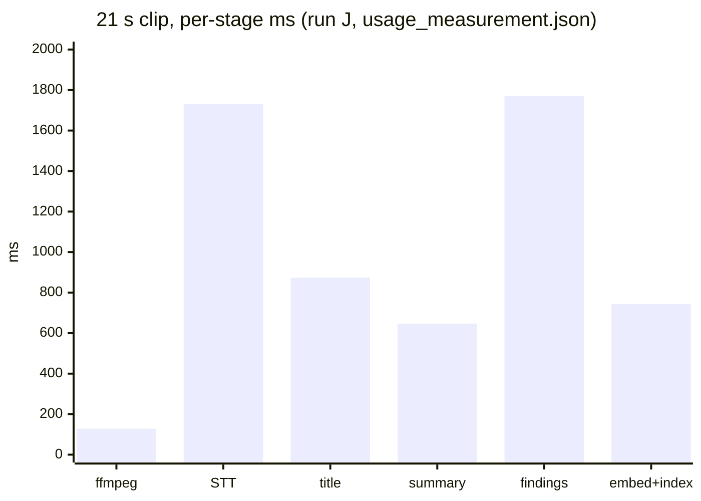
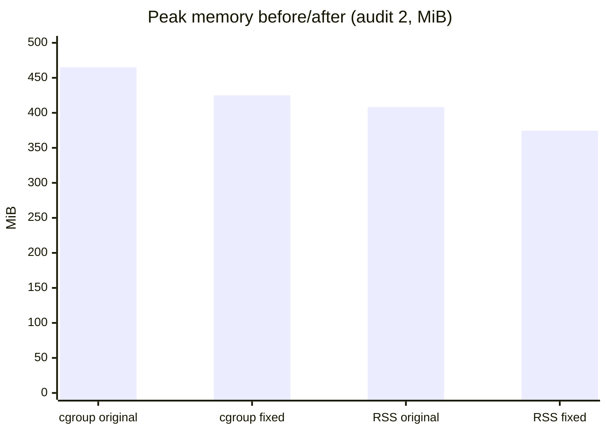

# Benchmarking and performance

Purpose: how performance was measured in this repo, under which conditions, what the numbers are, and which numbers do not exist yet (with the procedure to get them).

## Status legend

| Tag | Meaning |
| --- | --- |
| Measured | A number in a tracked doc or artifact, copied with its conditions. |
| Estimated | Arithmetic on measured numbers; the derivation is shown. |
| Not measured | No source. A procedure is listed in "Gaps". |
| Implemented / Verified / Experimental / Not implemented | As used in [optimization-and-experiments](optimization-and-experiments.md). |

Reading rules: every row is one run unless n is given. Mocked-provider runs measure the local pipeline, not provider latency. Numbers from different environments are never subtracted from each other.

---

## 1. Methodology

### 1.1 Offline workload gate: `scripts/benchmark_recruiter_demo.py --linux-gate` (Implemented, Verified)

Source: [`scripts/benchmark_recruiter_demo.py`](../../scripts/benchmark_recruiter_demo.py), CI job in [`.github/workflows/ci.yml`](../../.github/workflows/ci.yml) (`:77-81`).

What it exercises: the real FastAPI app through `TestClient`, real ffmpeg, a disposable PostgreSQL with pgvector (DSN must be a fresh loopback database named `recruiter_demo_test`), real BM25, RRF and FlashRank. Provider HTTP is intercepted (`fake_http`, `:113-156`) and any non-loopback socket raises. One synthetic clip (up to 10 MiB) runs: job 1 and a chat (cold), a second job overlapping a chat (the two embedding requests rendezvous on a barrier), a third job and chat (warm), then deletes.

What it asserts:

- Titles, answers and citation text are correct; exactly 3 passage and 3 query embedding requests are made; a successful reservation row exists per embedding request.
- Zero bytes of temp media remain after cleanup (`:237-238`).
- With `--linux-gate`: the container must be cgroup v2 with exactly 512 MiB memory, zero swap, 0.1 CPU (`:285-286`); cgroup peak must be under **450 MiB** and `oom`/`oom_kill` events must be zero (`:296-298`).

What it measures (JSON output): app import + startup seconds; first, overlapping and warm job seconds; first, overlapping and warm chat seconds; per-stage ms parsed from `metric=stage` log lines; mocked request counts; reserved audio ms and text ledger; Python peak RSS; Python and child CPU seconds; sampled peak temp-file bytes; cgroup peak bytes, memory events, CPU seconds.

Important reading note: "job seconds" is `POST /jobs` plus `GET /jobs/{id}/result` over loopback with mocked providers (`submit`, `:202-213`). It is **not** a network upload duration. It is the table label "upload" in the audit docs.

Run command (from [RECRUITER_DEMO](../RECRUITER_DEMO.md#offline-workload-check)):

```sh
docker run --rm --network container:ava-audit-db --cgroupns private \
  --memory 512m --memory-swap 512m --cpus 0.1 \
  --mount "type=bind,source=$PWD/scripts,target=/app/scripts,readonly" \
  --mount type=bind,source=/tmp/recruiter-benchmark.mp4,target=/tmp/recruiter-benchmark.mp4,readonly \
  -e TEST_DATABASE_URL=postgresql://audit@127.0.0.1:5432/recruiter_demo_test \
  ava-audit-backend python -m scripts.benchmark_recruiter_demo /tmp/recruiter-benchmark.mp4 --linux-gate
```

### 1.2 Evaluation latency harness (`evaluation/`) (Implemented, Verified)

Source: [`evaluation/README.md`](../../evaluation/README.md) (Latency section), [EVALUATION_REPORT §6](../../evaluation/EVALUATION_REPORT.md).

- Runs the real app (`ask_question(load_rag_chain(job))`) against a disposable `pgvector/pgvector:pg16` container, with real remote inference on free routes.
- Timers are the app's own telemetry: `dense_retrieval`, `sparse_retrieval`, `rrf`, `rerank`, plus generation time per provider attempt and end-to-end per question. The first question of each resume is flagged cold and excluded from warm stats.
- Query embeddings are sent in one batched request and timed separately, so `dense_retrieval` is the pgvector search only.
- Report-stage command (free, no provider calls beyond the answer stage): `evaluation/.venv/bin/python -m evaluation.runners.run_eval --mode local --stage report`. The answer stage uses `--stage answer --scope owner` (provider quota).
- Hardware and OS of the evaluation host: **not stated in the report.**

### 1.3 Usage measurement: `docs/usage_measurement.json` (Measured, no generating script)

Source: [`docs/usage_measurement.json`](../usage_measurement.json). The file describes its own method: a local run of the production image at 512 MiB on a throwaway pgvector database, a 21 s synthetic clip, one analysis and two chats; token counts are the providers' own reported usage from `provider_attempts`. No script in the repo produces it (the only readers are `scripts/export_eval_summary.py` and `web/src/components/pipelineFlows.js`). To repeat by hand, run one authorized upload and read stage times from `metric=stage` log lines and per-call data from the ledger:

```sql
SELECT route_alias, provider, status, elapsed_ms, reported_input_tokens, reported_output_tokens
FROM provider_attempts WHERE job_id = '<job id>' ORDER BY id;
```

### 1.4 Retrieval fixture and reranker benchmark (Implemented, Experimental data)

[`scripts/benchmark_retrieval.py`](../../scripts/benchmark_retrieval.py) (`--full-service`, `--require-linux --max-rss-mib 450`), documented in [BENCHMARK_NOTES](../BENCHMARK_NOTES.md). Synthetic labelled fixtures only. Note: BENCHMARK_NOTES `:38` says the Linux variants were "not run"; the workload gate in 1.1 has since run on Linux (see section 2), so that line is stale for the gate but still true for this specific script.

### 1.5 Browser experiment (Experimental)

[BROWSER_MEDIA_EXPERIMENT](../BROWSER_MEDIA_EXPERIMENT.md): loopback server + Playwright Chrome, three synthetic files, one run each. Reproduction commands are in that doc and need public npm access.

---

## 2. Environments

| ID | Used for | Hardware / OS | Limits | Providers | Notes |
| --- | --- | --- | --- | --- | --- |
| A | Audit 2 memory gate, before/after | Linux arm64 via Colima | 512 MiB, 0 swap, 0.1 CPU | Mocked | n=1; 120 s synthetic clip; same disposable pgvector for both images |
| B | Audit 1 cgroup test | Colima, Docker Engine 29.5.2; native ARM64 vs AMD64 under Rosetta | 512 MiB, 0 swap, 0.1 CPU; the AMD64 "one CPU" diagnostic kept memory and swap limits | Mocked | Image from `e1c906f`; three 120 s jobs |
| C | Native macOS workload | macOS arm64 | none | Mocked | three 120 s clips of 1,147,142 bytes; real ffmpeg, Postgres/pgvector, FlashRank |
| D | 12 Nov multi-provider gate | Linux ARM64 image | 512 MiB, 0 swap, 0.1 CPU | Mocked | 213 tests; [RECRUITER_DEMO:83](../RECRUITER_DEMO.md) |
| E | Import cost | macOS arm64 | none | none | `import backend.api`, n=5 mean |
| F | FlashRank load/inference | macOS arm64, Python 3.11.15, FlashRank 0.2.10, onnxruntime 1.31.1 | none | none | single run |
| G | Local BGE-small | one arm64 Mac | none | none | 16 synthetic passages |
| H | Browser ffmpeg.wasm | arm64 Mac, Playwright Chrome 157, native FFmpeg 9.0.2 | none | none | three synthetic files, one run each |
| I | Local run check, 13 Nov | Host hardware not stated; production image, `docker run --memory 512m`; real browser | 512 MiB (CPU not stated) | Real, free routes | 21 s clip, throwaway pgvector ([LOCAL_RUN_CHECK](../LOCAL_RUN_CHECK.md)) |
| J | Usage measurement, 13 Nov | Host hardware not stated; production image | 512 MiB (CPU not stated) | Real, free routes | 21 s clip, separate run from I |
| K | DeepEval + latency | "Local execution, remote inference"; hardware not stated; `pgvector/pgvector:pg16` in Docker | none stated | Real: Gemini, NVIDIA, OpenRouter, Groq (answers); Meta (judge) | NASA COP26 talk, 22 chunks, 45 goldens; mixed generators |
| L | CI native AMD64 gate | GitHub Actions `ubuntu-24.04` | 512 MiB, 0 swap, 0.1 CPU | Mocked | Gate is wired in CI, but **no CI result is quoted in a tracked doc**, so none appears here |

---

## 3. Results

### 3.1 Upload duration

| Measurement | Value | Env | Tag |
| --- | --- | --- | --- |
| Time from client to server over a real network | Not measured | n/a | Not measured |
| Server job time to result, 120 s clip, loopback, mocked providers: first / overlapping / warm | 4.218 s / 0.381 s / 0.336 s | C | Measured |
| Same, Linux ARM64 at 0.1 CPU (audit 1) | 19.468 s / 5.081 s / 2.724 s | B | Measured |
| Same, 12 Nov gate (cold / warm) | 70.30 s / 13.20 s | D | Measured |
| Same, audit 2 original vs fixed (first / warm) | 78.4 s / 11.6 s vs 86.6 s / 11.0 s | A | Measured |
| Server time to result, 21 s clip, real free providers | 8.1 s (run I); 6,187 ms (run J) | I, J | Measured, two separate runs |

### 3.2 Original vs compressed file size

| Item | Original | Compressed | Source / tag |
| --- | --- | --- | --- |
| Browser MP3 extraction, 30 s synthetic | 186,356 B | 180,940 B | Measured, env H |
| Browser MP3 extraction, 2 min | 744,681 B | 720,940 B | Measured, env H |
| Browser MP3 extraction, 10 min | 3,722,557 B | 3,600,868 B | Measured, env H |
| Saving | about 2.9%, 3.2%, 3.3% | | Estimated (my arithmetic); roadmap says "about 3%" |
| Server WAV chunk to FLAC, sent to Groq | WAV | about 45% smaller | Code comment, `transcriber.py:66`; no tracked artifact |
| Real user media | Not measured | Not measured | Not measured |

The app uploads the raw file; no browser compression ships. Synthetic fixtures are unusually compressible and do not predict real media.

### 3.3 Audio extraction

| Measurement | Value | Env | Tag |
| --- | --- | --- | --- |
| Backend ffmpeg convert + chunk, 21 s clip | 128 ms (run J); 0.15 s (run I) | J, I | Measured |
| Native video to WAV, 30 s / 2 min / 10 min (approximation, no probe or segment muxer) | 39 / 55 / 145 ms | H | Measured |
| ffmpeg.wasm in a worker, same files | 158 / 229 / 1,025 ms | H | Measured |
| Native MP3 extraction, same files | 125 / 231 / 1,039 ms | H | Measured |

### 3.4 Transcription

| Measurement | Value | Env | Tag |
| --- | --- | --- | --- |
| Groq `whisper-large-v3-turbo`, 21 s audio, 5 segments | 1,731 ms (J); 2.9 s (I) | J, I | Measured |
| Groq FLAC vs WAV upload, 5-minute request | 11.4 s vs 19.7 s | not stated | Code comment, single observation |
| Meta ASR, 5-minute file, sequential vs 30 s pieces x10 | 131 s vs 31 s | not stated | Code comment, paid route, single observation |
| Transcription accuracy (WER) | Not measured | | Not measured: the evaluation uses human captions in place of ASR |

### 3.5 Embedding and indexing

| Measurement | Value | Env | Tag |
| --- | --- | --- | --- |
| Gemini embed + pgvector index, 1 chunk | 743 ms (J); 0.6 s (I) | J, I | Measured |
| Index 22 chunks | 2,195 ms | K | Measured |
| 45 queries in one batched request | 2,303 ms (about 51 ms each) | K | Measured |
| Single query embedding, 21 s clip, two chats | 850 ms, 765 ms | J | Measured |
| Single query embedding in the NASA-talk run | Not measured (report says so) | K | Not measured |
| BGE-small local: load 111 ms, 16 passages 174 ms, per question 12.5 ms | | G | Measured, offline only |

### 3.6 Dense, sparse, RRF, rerank (per question, ms)

| Stage | n | p50 | p95 | p99 | max | Env |
| --- | --- | --- | --- | --- | --- | --- |
| Dense (pgvector search only) | 42 | 5 | 6 | 7 | 8 | K |
| BM25 | 42 | 1 | 1 | 1 | 1 | K |
| RRF | 42 | 0 | 0 | 0 | 0 | K |
| TinyBERT rerank (up to 12 candidates) | 42 | 8 | 10 | 11 | 12 | K |

Other: 21 s clip rerank 11 ms and 3 ms (J). FlashRank cold load 0.098 s, warm 0.000083 s, stress inference 0.085 / 0.084 s over 12 truncated pairs (F). Local fixture medians: BM25 + fusion 0.28 ms, rerank 13.5 ms (G).

### 3.7 LLM latency

| Measurement | Value | Env |
| --- | --- | --- |
| Generation per provider attempt, n=52 | p50 2,017, p95 3,694, p99 5,550, mean 2,152, max 5,625 ms | K |
| Groq gpt-oss-20b | p50 1,004, p95 1,828 | K |
| Gemini 2.5 Flash | p50 1,858, p95 2,796 | K |
| NVIDIA Nemotron 30B-A3B | p50 2,159, p95 3,213 | K |
| OpenRouter Nemotron free | p50 2,688, p95 3,099 | K |
| First-attempt answers (n=38) | p50 1,944, p95 3,667 | K |
| Failover answers (n=5) | p50 4,729, max 9,474 | K |
| 21 s clip stages: title (NVIDIA) 874, summary (Groq) 647, findings (Gemini) 1,772 ms | | J |
| 21 s clip chat, two calls | 1,772 ms and 1,454 ms | J |

### 3.8 End to end

| Measurement | Value | Env |
| --- | --- | --- |
| Chat per question, warm (n=40) | p50 2,085, p95 5,128, p99 7,946, mean 2,557, max 9,474 ms | K |
| Chat including cold (n=43) | p50 2,211, p95 5,068 ms | K |
| 21 s clip, analysis time to result | 6,187 ms (J); 8.1 s (I) | J, I |
| Hosted Render / Vercel path from a real browser | Not measured | |

**Two separate 21 s runs.** Run I ([LOCAL_RUN_CHECK](../LOCAL_RUN_CHECK.md)) took 8.1 s and run J ([usage_measurement.json](../usage_measurement.json)) took 6,187 ms. Both are 21 s synthetic clips on the production image at 512 MiB, but they are different runs on different routes and the sources do not explain the 1.9 s gap. They are not averaged. Stage sums: run J itemises 5,895 ms of 6,187 ms (my sum; 292 ms is not itemised); run I itemises about 8.05 s of 8.1 s.

### 3.9 Memory and CPU

| Measurement | Value | Env |
| --- | --- | --- |
| cgroup peak, audit 2: original / fixed | 465.2 / 425.0 MiB | A |
| Python peak RSS, audit 2: original / fixed | 408.3 / 374.6 MiB | A |
| cgroup peak, native ARM64 / AMD64 Rosetta 1 CPU (audit 1) | 380.83 / 472.28 MiB | B |
| cgroup CPU, same | 3.552 s / 7.356 s | B |
| cgroup peak, 12 Nov gate | 365.96 MiB, 0 OOM | D |
| Native macOS Python peak RSS | 429,932,544 B (410.02 MiB); CPU 6.076 s Python + 0.813 s child | C |
| Container peak, 21 s clip, real providers | about 327 MiB of 512 MiB | I |
| FlashRank process RSS / full-service import RSS | 274,120,704 B / 466,157,568 B (about 444.6 MiB) | F |
| BGE-small experiment process peak RSS | 326.3 MiB | G |
| Hosted Render RSS | Not measured | |

The 365.96 MiB (D, 12 Nov, 213 tests) and 465.2 MiB (A, original image from `6ac48a2`) figures are on different code and different runs. The sources do not reconcile them; do not read one as an improvement over the other.

### 3.10 Baseline vs optimized (only where both were measured)

| Metric | Before | After | Env | Source |
| --- | --- | --- | --- | --- |
| cgroup peak | 465.2 MiB | 425.0 MiB | A | perf doc |
| Python peak RSS | 408.3 MiB | 374.6 MiB | A | perf doc |
| Startup | 22.8 s | 12.9 s | A | perf doc |
| First-job title stage | 58.6 s | 10.6 s | A | perf doc |
| First job total | 78.4 s | 86.6 s (slower) | A | perf doc |
| Warm job / chat | 11.6 / 2.5 s | 11.0 / 1.6 s | A | perf doc |
| Generation calls for 3 jobs | 15 | 12 | A | perf doc |
| `import backend.api` RSS / time | 130.3 MiB / 604 ms | 112.3 MiB / 484 ms | E | perf doc |
| Delete median / p95 | 7.95 / 8.33 ms | 3.36 / 3.58 ms | local loopback Postgres, 40 jobs | perf doc (audit 1) |
| DB connections per delete | 3 | 1 | same | perf doc |
| Document scroll width at 320 px | 577 px | 320 px | browser | perf doc |

Not comparable (no baseline): original-app latency (never measured); pydub-era memory (not recorded); reranker on/off in latency terms.

### 3.11 Charts (measured data only)

Per-stage time, 21 s clip, run J only (ms; 5,895 of 6,187 ms itemised):



Peak memory, audit 2, 512 MiB / 0.1 CPU gate (MiB):



---

## 4. Gaps and how to close them

| Gap | Why it is empty | Procedure |
| --- | --- | --- |
| Upload duration over a real network | All upload timings are loopback or server-side | After approval and with the 1-job-per-IP-per-day quota in mind, run `curl -o /dev/null -w '%{time_total} %{size_upload}\n' -F file=@clip.mp4 -F demo_acknowledged=true https://<backend>/jobs` (form fields from the benchmark script), from the network under test. Server-side `metric=upload_body` and `metric=upload_copy` log lines give body read and copy times. |
| Real-media compression ratio | Only synthetic clips measured | Run the browser experiment with licensed real speech video (commands in [BROWSER_MEDIA_EXPERIMENT](../BROWSER_MEDIA_EXPERIMENT.md)) and compare bytes. |
| Hosted Render RSS and CPU | No hosted run | During an approved synthetic smoke test, read Render's memory/CPU metrics. Offline proxy: the gate in 1.1. |
| Native AMD64 gate on current head | CI results not in repo | Read the Actions artifacts for the run on the head commit (`gh run view`, read-only), then quote them. Pending per [ROADMAP_STATUS](../ROADMAP_STATUS.md). |
| Single-query embedding latency at scale | Eval batched all queries | Time `embed_batch(route, [q], query=True)` per question from `provider_attempts.elapsed_ms`. |
| Per-stage time on real long media | Longest real clips are 21 s and a 13.5 min talk (index only) | Approved upload of a 10 min clip; read `metric=stage` lines. |
| Pre-OOM-fix memory | Not recorded | See procedure in section 1 of [optimization-and-experiments](optimization-and-experiments.md). |
| Run-to-run variance | n=1 for most | Repeat the gate 5 times per image and report min / median / max. |

## Sources

- [`scripts/benchmark_recruiter_demo.py`](../../scripts/benchmark_recruiter_demo.py), [`.github/workflows/ci.yml`](../../.github/workflows/ci.yml)
- [`docs/engineering-audit/performance-and-optimization.md`](../engineering-audit/performance-and-optimization.md)
- [`docs/RECRUITER_DEMO.md`](../RECRUITER_DEMO.md), [`docs/ROADMAP_STATUS.md`](../ROADMAP_STATUS.md)
- [`docs/BENCHMARK_NOTES.md`](../BENCHMARK_NOTES.md), [`docs/BROWSER_MEDIA_EXPERIMENT.md`](../BROWSER_MEDIA_EXPERIMENT.md)
- [`docs/LOCAL_RUN_CHECK.md`](../LOCAL_RUN_CHECK.md), [`docs/usage_measurement.json`](../usage_measurement.json)
- [`evaluation/EVALUATION_REPORT.md`](../../evaluation/EVALUATION_REPORT.md), [`evaluation/README.md`](../../evaluation/README.md)
- [`backend/core/transcriber.py`](../../backend/core/transcriber.py), [`backend/core/telemetry.py`](../../backend/core/telemetry.py)
