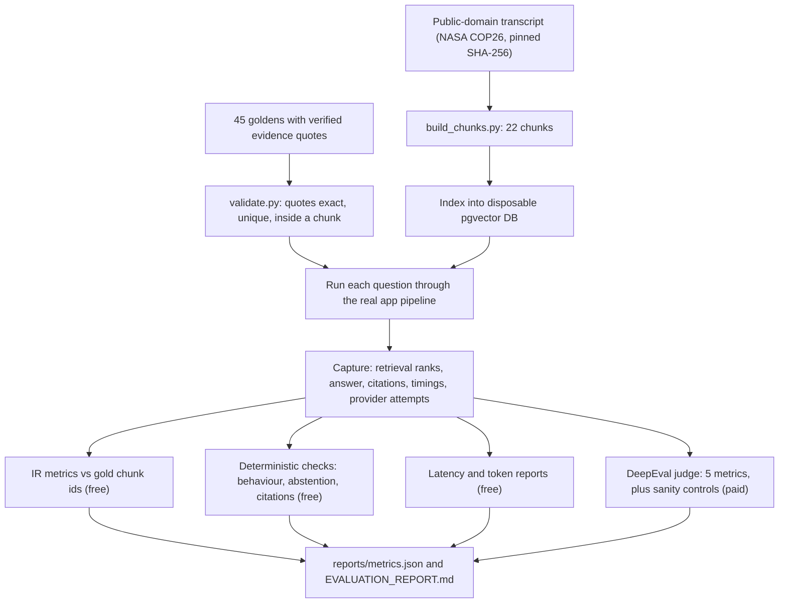

# Evaluation strategy

Purpose: explain how answer quality, retrieval quality, abstention, latency and cost were measured for this app, what the first evaluation run (v1) found, and what is still not covered.

**Status legend:** **Implemented** = code exists. **Verified** = run, with a number from a tracked source. **Planned** = not started. **Experimental** = built but not adopted. **Not implemented** = does not exist. **Not measured** = no evidence; how to measure is given.

Scope note: one run, on one source (a 13.5-minute NASA talk), with a mixed set of free generator models and one paid judge model. Every number below applies to that setup only. It is not a claim about accuracy on other videos.

## 1. Why evaluate

The app answers questions about a video transcript and must (a) cite exact transcript quotes with timestamps and (b) refuse when the transcript does not contain the answer. A demo cannot show either property reliably. The evaluation checks both with numbers. [Implemented, Verified]

The evaluation framework lives in [`evaluation/`](../../evaluation/). It runs the real app code locally with remote model calls, and changes no production behaviour ([EVALUATION_REPORT header](../../evaluation/EVALUATION_REPORT.md)).

## 2. Pipeline

Source for the flow: [evaluation/README.md](../../evaluation/README.md), [RUN_LOG.md](../../evaluation/RUN_LOG.md), [EVALUATION_REPORT §3](../../evaluation/EVALUATION_REPORT.md). [Implemented, Verified]

## 3. Dataset

**Source.** Karen St. Germain (NASA Director of Earth Science), COP26, 2021. Human-written captions, a US-government public-domain work. 13 min 35 s, 106 cues, 1,747 words, 22 chunks. The file's SHA-256 is pinned (`df3327e6…c55c6b`) and `build_chunks.py` refuses to run if it changes. [Implemented, Verified] ([SOURCE.md](../../evaluation/dataset/source/SOURCE.md))

**45 goldens** ([`config.py`](../../evaluation/config.py) `CATEGORY_COUNTS`; table in [EVALUATION_REPORT §3](../../evaluation/EVALUATION_REPORT.md)):

| Category | n | Expected behaviour |
|---|---|---|
| Direct factual | 10 | answer |
| Multi-passage | 6 | answer |
| Numerical / date | 6 | answer |
| Named entity | 5 | answer |
| Multi-hop | 5 | answer |
| Unanswerable | 6 | abstain |
| Ambiguous | 3 | answer or abstain |
| Misleading / false premise | 4 | correct the premise or abstain |

**How expected answers and evidence were built.**
- The goldens were written by Claude Opus 5.5, not by an automatic generator. **Human review is still pending** (`human_review` stays `pending`). [Implemented; review Planned] ([EVALUATION_REPORT §3, §10](../../evaluation/EVALUATION_REPORT.md), [README](../../evaluation/README.md))
- All 66 evidence quotes are checked by code: each must be an exact, unique substring of the transcript that falls inside a chunk. Gold chunk ids and cue-level timestamps are derived from those quotes. [Verified] ([`validate.py`](../../evaluation/dataset/validate.py), EVALUATION_REPORT §3)
- Unanswerable items carry `absent_terms`, which the validator confirms do not appear in the transcript. [Verified]
- The validator also fails if the golden file drifts from the category counts in `config.py`. [Implemented]

## 4. Metrics, and why each was chosen

| Metric | Why | Computed? | Status |
|---|---|---|---|
| Precision@K, Recall@K, hit@K, MRR, nDCG@K vs gold chunk ids | Cheap, deterministic, no judge cost. Shows whether retrieval puts the right chunk in the top 4 | All five computed, K=4 ([`metrics/ir.py`](../../evaluation/metrics/ir.py), [`reports/metrics.json`](../../evaluation/reports/metrics.json)) | Implemented, Verified |
| DeepEval Faithfulness (threshold 0.8) | Answers must stay inside the cited quotes | Yes | Implemented, Verified |
| DeepEval Answer Relevancy (0.7) | Answer addresses the question | Yes | Implemented, Verified |
| DeepEval Contextual Precision (0.7) | Relevant chunks ranked above irrelevant ones | Yes | Implemented, Verified |
| DeepEval Contextual Recall (0.7) | Retrieved context contains what the reference answer needs | Yes | Implemented, Verified |
| DeepEval Contextual Relevancy (0.5) | Share of retrieved text that is relevant | Yes | Implemented, Verified |
| Behaviour accuracy | Right action per category: answer, abstain, or correct the premise | Yes | Implemented, Verified |
| Abstention precision / recall / F1 | Refusal is a core promise, so it is scored on its own | Yes | Implemented, Verified |
| Citation validity (in context, exact quote, matching timestamps) | The app's central guarantee | Yes | Implemented, Verified |
| Latency per stage, tokens per call, cost | Free-tier limits make speed and token use real constraints | Yes | Implemented, Verified |

Thresholds are in [`config.py`](../../evaluation/config.py). The average score is the primary signal and pass rate is secondary. Abstention-type questions are scored only by the deterministic suite, because Answer Relevancy and Recall are undefined for a correct abstention. [Implemented]

## 5. Judge and sanity controls

- **Judge:** Meta `muse-spark-1.3`, paid standard tier, `reasoning_effort=low`, DeepEval 4.3.4 ([`config.py`](../../evaluation/config.py), [metrics.json meta](../../evaluation/reports/metrics.json)). A single judge, one run. [Implemented]
- **Sanity controls:** four deliberately bad cases (a fabricated answer, an off-topic answer, irrelevant context, a contradiction) were scored. **All four scored 0.0, which is the expected result.** A 0 there means the judge correctly rejects bad output; it is not a failure of the app. [Verified] ([EVALUATION_REPORT §4.1](../../evaluation/EVALUATION_REPORT.md))
- **Evaluation-only deviations** (production unchanged): per-job lifetime budget applied per question; queries embedded in one batched request and cached; `DEEPEVAL_DISABLE_TIMEOUTS=1`, because DeepEval's global timeout had silently dropped half the cases. [Implemented]
- The app was forced to free routes only; paid Meta routes were disabled for it ([`config.py` `FORCED_APP_ENV`](../../evaluation/config.py)). [Verified]

## 6. Results

All from [EVALUATION_REPORT](../../evaluation/EVALUATION_REPORT.md) and [`reports/metrics.json`](../../evaluation/reports/metrics.json), run of 13 Nov 2026. n=45 questions; 32 were judged by DeepEval (the answerable categories).

### 6.1 DeepEval, final answer (top 4 chunks)

| Metric | Avg | Passed / scored |
|---|---|---|
| Faithfulness | 1.000 | 32/32 |
| Answer Relevancy | 0.986 | 32/32 |
| Contextual Precision | 0.924 | 28/32 |
| Contextual Recall | 0.938 | 30/32 |
| Contextual Relevancy | 0.237 | 4/32 |

Before reranking (RRF top 12): Contextual Precision 0.877 (25/31, one judge JSON error), Contextual Recall 1.000, Contextual Relevancy 0.126.

By category, Contextual Recall was 1.000 for direct, numerical and named-entity questions, 0.833 for multi-passage and 0.800 for multi-hop. Named-entity questions had the weakest Contextual Precision (0.733). [Verified] ([§4.1](../../evaluation/EVALUATION_REPORT.md))

### 6.2 Application behaviour (deterministic)

| Check | Result |
|---|---|
| Behaviour accuracy | 43/45 (0.956). Both misses were HTTP 503 errors, not wrong answers |
| Abstention (6 unanswerable) | 6 true, 0 false, 0 missed; precision, recall, F1 = 1.0 |
| Citation validity | 56/56 citations: in context, exact quote, timestamps match |
| Answered with a gold-chunk citation | 100% of answered questions |
| Adversarial raw outputs | 15/15 handled |

[Verified] ([§4.2](../../evaluation/EVALUATION_REPORT.md), [metrics.json](../../evaluation/reports/metrics.json))

### 6.3 Retrieval (gold chunk ids, k=4, n=37 questions with gold evidence)

| Variant | recall@4 | MRR | nDCG@4 | precision@4 |
|---|---|---|---|---|
| Dense only | 1.000 | 0.946 | 0.951 | 0.358 |
| BM25 only | 0.892 | 0.867 | 0.826 | 0.297 |
| Hybrid RRF, no rerank | 0.964 | 0.928 | 0.909 | 0.338 |
| Hybrid + TinyBERT (production) | 0.977 | 0.892 | 0.897 | 0.345 |

Precision@4 is low by construction: most questions have one gold chunk and four are returned. On this 22-chunk corpus dense alone matched or beat production, and the reranker lowered MRR on the hybrid list (0.928 to 0.892). Offline, on BM25 alone, adding the reranker raised recall@4 from 0.897 to 0.974 (95% CI [+0.026, +0.141], n=39). The report concludes that this source is too small to justify removing the reranker or the hybrid design. [Verified]

**Candidate-pool recall: two figures in tracked sources.**

| Source | dense@10 | BM25@10 | fused@12 |
|---|---|---|---|
| [EVALUATION_REPORT §4.3](../../evaluation/EVALUATION_REPORT.md) | 0.949 | 0.923 | 0.949 |
| [experiment_comparison.md](../../evaluation/reports/experiment_comparison.md) | 1.000 | 0.973 | 1.000 |

The report states its values are against "the full gold set"; the comparison file does not state a denominator. The pairs are consistent with 37/39 vs 37/37 and 36/39 vs 36/37, but that is my inference from the arithmetic, not a stated fact. Treat the cause as unconfirmed. [Verified for both values; cause Not confirmed]

### 6.4 Latency, tokens, cost

| Measure | Value | Source |
|---|---|---|
| Dense search / BM25 / RRF / rerank, p50 | 5 / 1 / 0 / 8 ms | [§6](../../evaluation/EVALUATION_REPORT.md) |
| Generation per provider attempt, p50 / p95 | 2,017 / 3,694 ms | §6 |
| End to end per question, warm, p50 / p95 / p99 | 2,085 / 5,128 / 7,946 ms (n=40) | §6 |
| First-attempt answers vs answers needing failover, p50 | 1,944 ms (n=38) vs 4,729 ms (n=5) | §6 |
| Tokens per question attempt (reported) | about 830 in, 150 out; 1.27 attempts per question | [§5.2](../../evaluation/EVALUATION_REPORT.md) |
| Generation and embedding cost | $0 (free routes) | §5.2 |
| Judge cost, this report's run | $5.6087, 1,284 calls | [§5.1](../../evaluation/EVALUATION_REPORT.md) |
| Judge cost, all runs in ledger | $9.192293, 2,220 calls | `evaluation/reports/judge_ledger.json` (local, git-ignored; v1 total also in [EVALUATION_REPORT §5.1](../../evaluation/EVALUATION_REPORT.md), v2 total $3.58 in [v2 README](../../future-improvements/v2-rag-pipeline/README.md)) |

Single-question query embedding latency was **Not measured** (45 queries were embedded in one batch, 2,303 ms), so end-to-end figures understate live latency. Hosted (Render) latency is also **Not measured**.

Rejected model outputs: 14 of 57 responses (5 crossed a chunk boundary, 4 differed only in spacing, 3 were stitched quotes, 2 were empty abstentions, 0 fabricated). Rejections cause the failover tail above. [Verified] ([§7](../../evaluation/EVALUATION_REPORT.md))

## 7. Why Contextual Relevancy is low

Contextual Relevancy averaged 0.237 (threshold 0.5; 4/32 passed). This is structural, not a retrieval fault. A 500-character chunk holds about five sentences, and a single-fact question needs one of them, so the judge counts the other sentences as irrelevant. It rises for questions that need several facts: 0.141 (direct factual), 0.126 (numerical), 0.094 (named entity), but 0.420 (multi-passage) and 0.484 (multi-hop). Smaller chunks would raise it, but an offline what-if showed quote coverage at 4 chunks falling from 0.974 (500-char) to 0.855 (about 350 chars) and 0.784 (about 250 chars), so chunks were not shrunk. [Verified, what-if is offline and uses the goldens' own quotes, which favour the current chunks] ([§4.1, §8.1](../../evaluation/EVALUATION_REPORT.md))

## 8. v2 A/B summary and why it is parked

v2 bundled 11 changes (tolerant quote matching, quote re-attribution, empty-answer abstention, number/name check, sentence-aware chunking, new prompt, and others) aimed at the v1 failures. Paired comparison, same pinned generator and embedding model, 31 questions both had answered (latency pairs: n=24):

| | v1 | v2 (iteration 1) |
|---|---|---|
| HTTP 503 | 5 | 0 |
| Behaviour accuracy | 0.839 | 1.000 |
| Answer Relevancy (paired n=26) | 0.981 | 0.941 |
| End-to-end p95 (paired n=24) | 4,519 ms | 6,289 ms, latency gate failed |

The v2 pipeline was **not adopted**: v2 answers were longer, the latency gate failed, the concision fix was never re-measured, and the A/B was incomplete (last 14 v1 questions and a repeat judge run not done). Judge spend $3.58. The code is kept as a patch, not in the app. [Experimental, parked] ([v2 README](../../future-improvements/v2-rag-pipeline/README.md), [comparison](../../future-improvements/v2-rag-pipeline/reports/comparison_v1-pinned_vs_v2-iter1.md))

## 9. Limitations

- Single source, 22 chunks: absolute retrieval numbers are optimistic. Chance recall@4 on this corpus is about 0.18 ([§8.10](../../evaluation/EVALUATION_REPORT.md)).
- Single judge, single run: variance unmeasured; thresholds are provisional.
- Mixed generators: four free models answered because Gemini's daily cap was hit; free models are not deterministic (U-005 failed once, then passed).
- Goldens authored by an AI and mechanically verified, not human-reviewed.
- Human captions stand in for speech-to-text output, so transcription quality is **Not evaluated**.
- No other video, language, or noisy audio was evaluated.

## 10. Planned next evaluations (all Planned, none done)

1. Multi-source dataset: 3-5 public-domain talks of 100+ chunks each, so retrieval is non-trivial ([EVALUATION_REPORT §8.10](../../evaluation/EVALUATION_REPORT.md)).
2. Human review of the 45 goldens.
3. A second, identical judge run to measure noise, or a second judge model.
4. Pin one generator when comparing variants.
5. Run the free offline suite in CI.
6. Cheaper judging (`minimal` reasoning, no reasons on passing cases).
7. Representative relevance evaluation on labelled, permissible media with a free or local judge ([ROADMAP_STATUS, remaining gates](../ROADMAP_STATUS.md)).

## Sources

- [evaluation/EVALUATION_REPORT.md](../../evaluation/EVALUATION_REPORT.md)
- [evaluation/README.md](../../evaluation/README.md)
- [evaluation/RUN_LOG.md](../../evaluation/RUN_LOG.md)
- [evaluation/config.py](../../evaluation/config.py)
- [evaluation/metrics/ir.py](../../evaluation/metrics/ir.py)
- [evaluation/reports/metrics.json](../../evaluation/reports/metrics.json)
- [evaluation/reports/experiment_comparison.md](../../evaluation/reports/experiment_comparison.md)
- `evaluation/reports/judge_ledger.json` (local, git-ignored; v1 total also in [EVALUATION_REPORT §5.1](../../evaluation/EVALUATION_REPORT.md), v2 total $3.58 in [v2 README](../../future-improvements/v2-rag-pipeline/README.md))
- [evaluation/dataset/source/SOURCE.md](../../evaluation/dataset/source/SOURCE.md)
- [evaluation/dataset/validate.py](../../evaluation/dataset/validate.py)
- [future-improvements/v2-rag-pipeline/README.md](../../future-improvements/v2-rag-pipeline/README.md)
- [future-improvements/v2-rag-pipeline/reports/comparison_v1-pinned_vs_v2-iter1.md](../../future-improvements/v2-rag-pipeline/reports/comparison_v1-pinned_vs_v2-iter1.md)
- [docs/ROADMAP_STATUS.md](../ROADMAP_STATUS.md)
