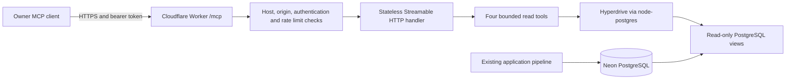

# Architecture

The Worker uses `createMcpHandler` from `agents/mcp/server` with `legacy: "stateless"`. Each request authenticates independently. There are zero Durable Object bindings and zero OAuth routes in v1. Use an MCP client that sends the static `Authorization` header. Cloudflare's handler serves Streamable HTTP. [Cloudflare MCP transport](https://developers.cloudflare.com/agents/model-context-protocol/protocol/transport/)

The Worker reads a fixed schema selected by `MCP_ENVIRONMENT`. Production reads the `ava_mcp` views. The named Preview belongs to the same Worker and reads `ava_mcp_preview` through a distinct Hyperdrive configuration and reader identity scoped to synthetic data. Separate credentials and rate-limit namespaces give each target its own access boundary. [Cloudflare Preview resource isolation](https://developers.cloudflare.com/workers/previews/resources/)

A PostgreSQL query uses parameterized values and reads explicit view columns. Hyperdrive handles upstream pooling. Configure query caching off so eligibility, status, and deletions are read from PostgreSQL. An explicit share record maps each listed source job to a separate UUID alias. The `shared_jobs` and `shared_chunks` views filter out unshared and deleting rows. Content requires its own approval and a completed `hybrid-v1` record. Legacy records are limited to permitted metadata. Media ingestion, transcription, embeddings, vector retrieval, reranking, and RAG stay in the existing application. The Worker deploys as `ai-video-assistant-mcp`, independently of the portfolio Worker. [Cloudflare node-postgres guidance](https://developers.cloudflare.com/hyperdrive/examples/connect-to-postgres/postgres-drivers-and-libraries/node-postgres/) · [Hyperdrive query caching](https://developers.cloudflare.com/hyperdrive/concepts/query-caching/)

| Component | Version |
| --- | --- |
| Node | 24.14.0 |
| `agents` | 0.33.0 |
| `@modelcontextprotocol/server` | 2.4.0 |
| `zod` | 4.6.7 |
| `pg` | 8.23.1 |
| `wrangler` | 4.160.0 |
| `typescript` | 5.9.3 |
| MCP Inspector | 2.13.0 |
